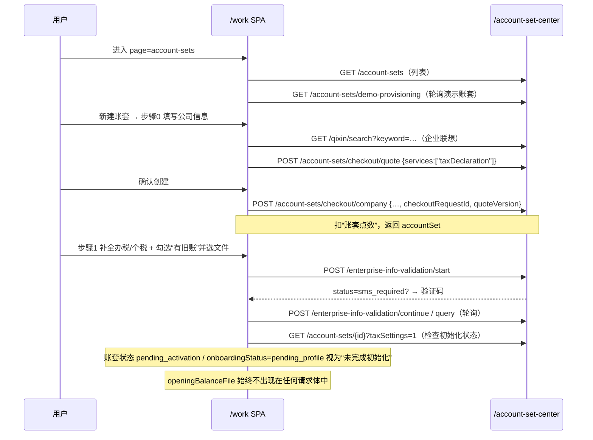

# 10 · 账套导入实现（page=account-sets）

> 对象：`https://daizhang.youshu.yun/work/?threadId=<id>&page=account-sets`
> 方法：对公开发布的 `/work` Vite bundle 做静态分析，并与仓库内已归档版本比对；仅被动观察，未登录、未提交表单。
> 证据 JSON：[`../03-analysis/account-set-import.json`](../03-analysis/account-set-import.json)

---

## 0. 结论（先看这一段）

`page=account-sets` 页面**没有**一个名为“导入账套”的固定接口。真实存在的“导入”有两条，且都不是一个简单的 `POST /import`：

1. **建账向导里的“期初旧账 / 旧账文件”**（`hasOpeningBalance=yes` → 上传 `.xls/.xlsx/.csv`）。
   —— **观察**：该文件在提交前被显式丢弃，客户端从不把它发给服务端（详见 §2.3）。它是一个**未接线的 UI 占位**。
2. **AI 子智能体 `legacy-book-import`（“导入旧账”）**。
   —— **观察**：用户在会话里把旧账文件作为**附件**上传，Agent 依据服务端下发的技能
   `legacy-book-import/SKILL.md` 读取并录入。任务以 `legacy_book_import` 业务类型进入**任务中心**。

一句话：**“账套导入”在本产品里是 Agent 工作流，不是表单直传。**

---

## 1. 证据与版本

| 证据 | 位置 | SHA-256 / 说明 |
|---|---|---|
| 归档抓取 | `02-scripts/work/index-yoSd2Nx7.js` | `098e3f…265e`（2026-10-12 首次抓取） |
| 实时复核 | `02-scripts/work/index-CiSnIgwe.js` | `691cf9…b0e26`（2026-10-12 复核，行为不变） |
| 事实抽取 | `03-analysis/account-set-import.json` | 结构化观察 + 契约 |
| 实时 URL | `/work/assets/index-CiSnIgwe.js` | 公开静态资源，无需登录 |

关键代码位置（字节偏移，live bundle）：

- 建账向导组件 `NIe`：`1643879`（归档版） / `1631997`（live 版）
- 期初旧账表单项 `openingBalanceFile`：全文共 3 处 —— 草稿剔除、提交剔除、表单定义
- 附件上传 `raw-upload`：`2373318`
- 子智能体定义 `legacy-book-import`：`1444867`
- 动态工具/技能标签表 `N9` / `U9e`：`1445xxx`

> 推断边界：本次只跑静态分析；服务端 SKILL 正文、动态工具 schema 不在 bundle 内（**未知**）。

---

## 2. 路径 A：建账向导的“期初旧账 / 旧账文件”

### 2.1 入口与步骤

`page=account-sets` 渲染账套中心（`/account-set-center`）。点“新建账套”进入两步向导：

| 步骤 | 标题（新建） | 标题（编辑） | 主要内容 |
|---|---|---|---|
| 0 | 新建公司 | 账套信息 | 公司名称、纳税人识别号、分配会计、启用账期（年/月） |
| 1 | 补全信息 | 财务信息 | 办税员/个税档案、**期初旧账 + 旧账文件** |

默认值（`QL()`）：

```js
{
  currency: "CNY",
  startYear / startMonth: 上个月,
  status: "active",
  declarationType: "zero",
  accountingStandard: "small_enterprise",
  hasOpeningBalance: "none",          // 默认“无旧账”
  taxHandlerIdentity: "legal_rep",
  verifyCodeMode: "hosted",
  personalTaxAuthMode: "2"
}
```

草稿持久化到 `localStorage["account_set_create_wizard_draft_v1"]`（**观察**：写入前会剔除
`openingBalanceFile` 及各种密码字段，因为 `File` 不可序列化）。

### 2.2 “旧账文件”控件（逐字）

```jsx
<Form.Item
  noStyle
  shouldUpdate={(a, b) => a.hasOpeningBalance !== b.hasOpeningBalance}>
  {({ getFieldValue }) => getFieldValue("hasOpeningBalance") === "yes" ? (
    <Form.Item
      name="openingBalanceFile"
      label="旧账文件"
      valuePropName="fileList"
      getValueFromEvent={(e) => (Array.isArray(e) ? e : e?.fileList)}
      rules={[{ required: true, message: "请上传旧账文件" }]}>
      <Upload accept=".xls,.xlsx,.csv" beforeUpload={() => false} maxCount={1}>
        <div className="account-set-old-book-upload-box">
          <Icon />
          <span>请上传启用账期前的科目余额表</span>
        </div>
      </Upload>
    </Form.Item>
  ) : null}
</Form.Item>
```

要点（**观察**）：

- 仅当 `hasOpeningBalance === "yes"` 才出现，且**必填**；
- `beforeUpload = () => false` → Ant Design 不自动上传，等待手动/自定义；
- 接受 `.xls/.xlsx/.csv`，单文件；
- 文案明确指“**启用账期前的科目余额表**”。

### 2.3 关键发现：文件被丢弃（未接线）

两处代码把旧账字段从请求里删掉：

```js
// 1) 草稿持久化（jn）
const Pe = { ...values };
for (const k of ["openingBalanceFile","nationalTaxPassword",
                 "personalTaxPassword","personalTaxRealNamePassword"]) delete Pe[k];

// 2) “创建公司”提交（ja → createCompanyAccountSet）
const Pe = { ...form.getFieldsValue(true) };
for (const k of ["hasOpeningBalance","openingBalanceFile",
                 "taxLoginProfileId","personalTaxLoginProfileId",
                 "taxHandlerName","taxHandlerIdentity","taxHandlerPhone",
                 "verifyCodeMode","nationalTaxPassword",
                 "personalTaxAuthMode","personalTaxPassword",
                 "personalTaxRealNameAccount","personalTaxRealNamePassword"]) delete Pe[k];
await api.createCompanyAccountSet({ ...Pe, checkoutRequestId, quoteVersion });
```

第 1 步“同步企业信息”（`Kn()`）同样只发送：

```
companyName, taxNumber, areaCode, accountSetId, taxLoginProfileId,
personalTaxAuthMode, personalTaxPassword?, personalTaxLoginProfileId?
```

另外 `createAccountSet`（`POST /account-set-center/account-sets`）在 API 客户端里**有定义、
零调用**（`CTe` 仅出现在定义处）。live 与归档两个版本行为一致。

> 结论（**推断**）：向导里的“期初旧账/旧账文件”是产品预留位；真正的旧账数据导入没有走
> 这条表单链路。要么由后续 Agent 流程承接，要么仍是未完成功能（**未知**）。

### 2.4 建账网络时序（不含旧账文件）



---

## 3. 路径 B：Agent 子智能体 `legacy-book-import`

### 3.1 子智能体契约

```js
{ runtimeName: "legacy-book-import",
  displayName: "导入旧账",
  description: "导入 Excel 旧账、历史凭证、科目余额和期初余额，并支持账套初始化。" }
```

- 技能文件：`legacy-book-import/SKILL.md`，UI 标签“读取旧账导入规则”；
- 外部任务类型：`legacy_book_import`（与 `tax_filing` / `bookkeeping` / `invoice_issue` 并列，
  由任务中心 `/finance/business-batches` 展示）。

### 3.2 文件如何到达 Agent（附件管道）

用户在会话里上传文件（正是 `.xlsx/.xls/.csv` 等会被这里接收）：

| 项 | 值 |
|---|---|
| 上传 | `POST /api/attachments/raw-upload`，multipart 字段名 `files` |
| 限额 | 最多 6 个；单个 ≤ 20MB；合计 ≤ 32MB |
| 返回 | `{ attachments: [{ artifactHandle, name, mimeType, size }] }` |
| 回读 | `GET /api/attachments/{artifactHandle}` |
| 注入 Agent 的用户消息 | `# Files mentioned by the user:` … `## {name} (artifactHandle: {handle})` … `## My request for Codex:` |

**重要限制（观察）**：xlsx/xls/csv 默认只传**元数据**给模型；纯文本可用 `finance_artifact_read`，
PDF/Office/图片正文“当前不支持直接读取”。因此 Excel 旧账必须由 Agent **用工具/命令解析**后再录入。

### 3.3 Agent 可用能力（与导入强相关）

动态工具（客户端已知标签）：

`account_context`、`finance_context_resolve`、`finance_query`、`finance_query_catalog`、
`finance_task_status`、`voucher_check`、`voucher_create`、`exec`、`list`、`read`、`update_plan` …

可查询能力（`finance_query_catalog`）中与旧账导入直接相关：

| nodeId | 含义 |
|---|---|
| `enterprise_account.account_set` | 账套信息 |
| `enterprise_account.subject_system.all` | 科目体系（导入前对齐科目） |
| `enterprise_account.auxiliary_accounting.all` | 辅助核算 |
| `voucher.generated.list` / `voucher.generated.summary` | 已生成凭证（查重/核对） |
| `report.balance_sheet` / `report.income_statement` | 与期初/余额勾稽 |

> **推断**：典型导入工作流 = `read` 读取 SKILL 规则 → `exec` 解析 Excel →
> `finance_query(enterprise_account.subject_system.all)` 对齐科目 →
> `voucher_create`/批量录入历史凭证 + 期初余额 → `report.*` 勾稽校验 →
> `finance_task_status` 汇报。

### 3.4 任务中心

```
GET  /finance/business-batches?threadId=&cursor=&limit=
GET  /finance/business-batches/{batchId}
POST /finance/business-batches/{batchId}/archive
```

`businessType ∈ {tax_filing, bookkeeping, invoice_issue, legacy_book_import}`。

---

## 4. 接口契约汇总

### 4.1 建账/账套（`/account-set-center`）

```
GET    /account-set-center/account-sets
GET    /account-set-center/account-sets/{id}?taxSettings=1
POST   /account-set-center/account-sets                         # 已定义、从未调用（遗留）
POST   /account-set-center/account-sets/checkout/quote          # {services:["taxDeclaration"], couponIds:[]}
POST   /account-set-center/account-sets/checkout/company        # 扣点数建账
POST   /account-set-center/account-sets/checkout/{id}/capabilities
PUT    /account-set-center/account-sets/{id}
DELETE /account-set-center/account-sets/{id}                    # 可能返回 { archived:true }
GET    /account-set-center/account-sets/demo-provisioning
GET    /account-set-center/account-sets/employees
GET    /account-set-center/qixin/search?keyword=
```

### 4.2 初始化 / 办税档案

```
POST /account-set-center/enterprise-info-validation/start
POST /account-set-center/enterprise-info-validation/continue
POST /account-set-center/enterprise-info-validation/query
GET  /account-set-center/account-sets/{id}/enterprise-info-validation/status
GET  /account-set-center/tax-login-profiles
POST /account-set-center/tax-login-profiles
POST /account-set-center/tax-login-profiles/onboarding-candidate
POST /account-set-center/tax-login-profiles/verify-personal-create
POST /account-set-center/tax-login-profiles/{id}/verify-enterprise[-sms]
POST /account-set-center/tax-login-profiles/{id}/verify-personal
POST /account-set-center/tax-login-profiles/account-set/{id}/verify-personal-password
POST /account-set-center/tax-login-profiles/{id}/password-reset/send-sms | /submit
```

### 4.3 状态

- 账套状态：`active`（正常）、`disabled`（停用）、`pending_activation`（待启用）；
- 补全标记：`onboardingStatus === "pending_profile"`；
- 判定函数：`fc(x) = x.status==="pending_activation" || x.onboardingStatus==="pending_profile"`。

---

## 5. 与本地复刻工程的差异

| 维度 | 线上（本次结论） | 本仓库 `06-workbench` |
|---|---|---|
| 导入触发 | AI 子智能体 `legacy-book-import`（会话附件） | 网页“↓ 导入账套” + `legacy_book_import` 工具 |
| 文件通道 | `/api/attachments/raw-upload` → `artifactHandle` | 前端 base64/文本直传 `/api/import/parse` |
| 输入格式 | 未观察到固定模板（服务端 SKILL 决定） | 1 个 JSON 或 4 张 CSV（账套/科目/期初/凭证），GBK |
| 校验 | Agent + `report.*` 勾稽 | `validateImportPayload()` 预检 + 事务 |
| 建账向导旧账文件 | 收集但不发送（占位） | 直接用于导入 |

> 复刻建议：保持当前 `importAccountSet()` 的“预检 + 事务”能力；若要贴近线上，可再加一层
> **附件式导入**（`raw-upload` → handle → 解析），并把导入结果落到可查询的任务批次。

---

## 6. 未知与后续

1. 服务端 `legacy-book-import/SKILL.md` 正文（模板列、科目映射、勾稽规则）未下发到客户端；
2. 是否存在未在客户端声明的动态工具（如 `finance_artifact_read` 的完整 schema、或专用导入工具）；
3. `legacy_book_import` 任务的状态机字段与进度语义；
4. “期初旧账/旧账文件”UI 是灰度中还是已废弃——建议登录后抓一次真实创建请求确认。

复现命令（不登录，仅静态）：

```bash
curl -s https://daizhang.youshu.yun/work/ | grep -oE '/work/assets/index-[A-Za-z0-9]+\.js'
curl -s https://daizhang.youshu.yun/work/assets/index-CiSnIgwe.js -o work.js
# 然后在 work.js 中检索 openingBalanceFile / legacy-book-import / raw-upload
```
