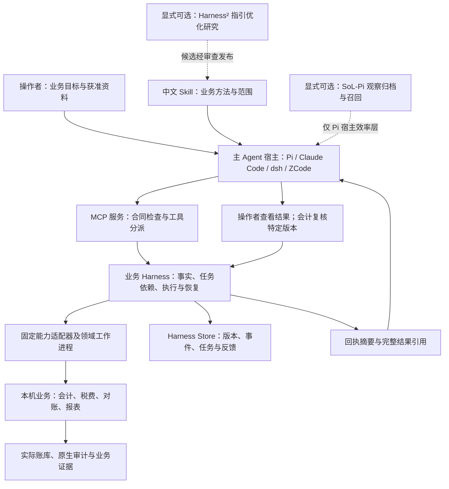
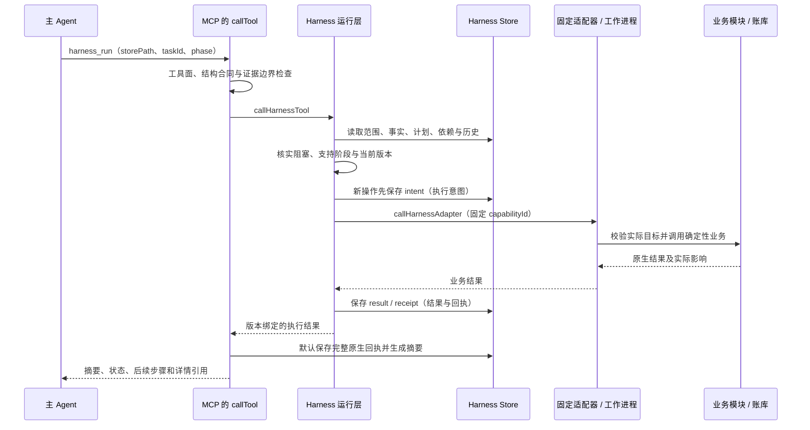
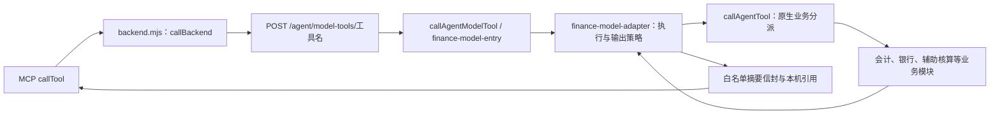
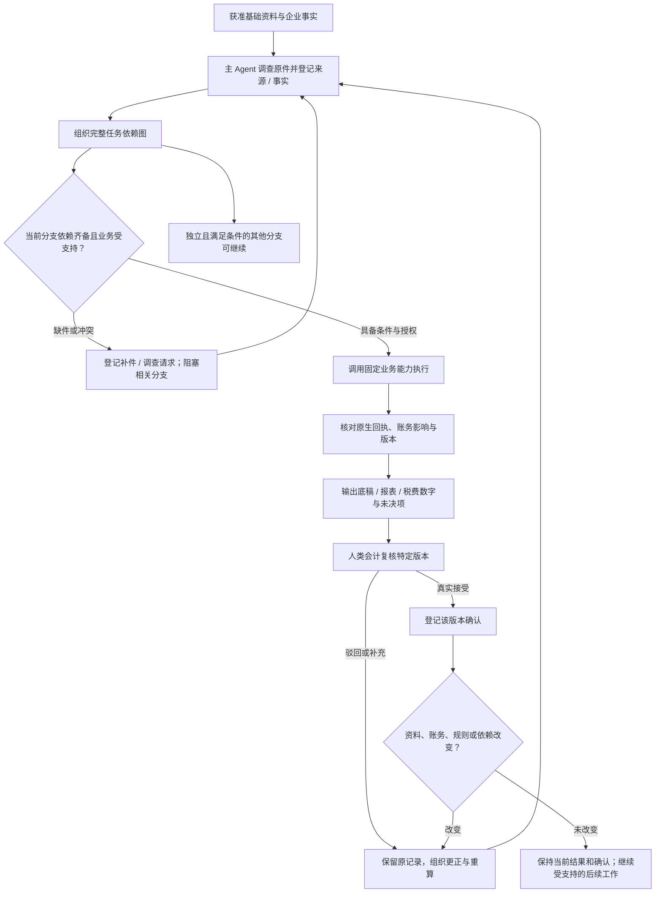
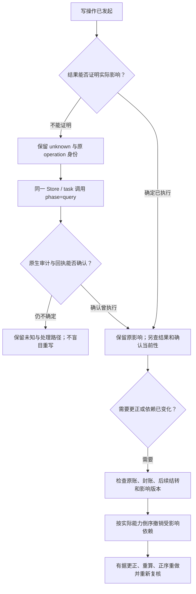

# 中国财税 Agent：架构、调用链与流程编排

本仓库为中国企业的财务核算、税费计算、会计复核与持续分析开发 Agent。使用方式是本机单用户、一名操作者处理多家企业、每家企业一个账套。主 Agent 理解目标和资料，本机工具执行已支持的确定性业务，专业会计确认具体版本的结果。中国财税是产品方向，具体支持以能力合同、业务模块和实际证据为准。

这里解释现有实现与扩展原则。安装、模型配置和首次运行使用[四宿主统一入口](../05-reconstruction/codex/hosts/START-HERE.md)；逐业务文件与测试见[代码索引](CODE-INDEX.md)；工作分工、当前进度和验收证据仍在 [Issue / PR](https://github.com/huxiaoyang-code/taxes-agent/issues)。

## 一、先分清谁在思考，谁在执行

| 层次 | 负责什么 | 实际入口 |
|---|---|---|
| 主 Agent 与宿主 | 接收目标、调查资料、判断适用业务、选择能力、构造有依据的请求并解释结果 | Pi、Claude Code、dsh、ZCode 的[统一配置入口](../05-reconstruction/codex/hosts/START-HERE.md) |
| 技能（Skill） | 告诉 Agent 怎么开展企业接手、核算、分析和年度工作，按需读取指引 | [企业财税顾问](../05-reconstruction/codex/skills/taxes-company-advisor/SKILL.md)、[Harness](../05-reconstruction/codex/skills/harness/SKILL.md)、[年度结算](../05-reconstruction/codex/skills/annual-close/SKILL.md) |
| 工具协议（MCP） | 公布可调用工具与输入合同，检查请求，分派调用，返回结构化结果 | [MCP 服务](../05-reconstruction/codex/mcp/finance-mcp/server.mjs)与[工具合同](../05-reconstruction/codex/mcp/finance-mcp/tools.mjs) |
| 业务 Harness | 保存来源和事实、依赖图、执行意图、结果版本、会计反馈与恢复历史 | [运行层](../06-workbench/server/harness-runtime.mjs)、[存储层](../06-workbench/server/harness-store.mjs) |
| 确定性业务工具 | 核验输入和实际账套，执行核算、税费规则、对账、报表及受控写入 | [固定能力适配器](../06-workbench/server/harness-adapters.mjs)与各业务模块 |
| 账库与业务证据 | 保存正式凭证、明细、审计、备份，以及可核验的原生执行结果 | SQLite 账库和各业务 Store；不是宿主聊天记录 |

Agent 的文字说明不会自动变成一张凭证；Skill 也不直接运行公式。真正执行时，Agent 必须提交符合合同的请求，由固定本机能力检查并执行。解析子 Agent 是可选的资料调查角色，其工具限制按宿主核实，不能自动取得写账或会计批准权限。



图中主要实线是新生成 `harness` 工具面的日常业务路径。MCP 的其他兼容工具有独立调用链，见下一节。四个宿主均可作为主 Agent，其他三者不依赖 Pi 代为运行。业务 Harness、Google Research Harness²、SoL-Pi 是三个不同层次；后二者默认关闭，目前禁止组合，具体方法与限制分别见 [Harness²](HARNESS2-INTEGRATION.md)和 [SoL-Pi](SOL-PI-INTEGRATION.md)。

## 二、一次工具调用实际经过哪里

MCP 服务的 `callTool` 先查工具名称、当前工具面（profile）、参数和可用性，再按工具种类分派。`FINANCE_MCP_PROFILE=harness` 只公布并允许 Harness 工具及 `skills_list` / `skills_read`；未设置该变量的既有客户端保留较大的兼容工具面。工具面约束不等于文件系统沙箱，也不等于会计批准。

### 1. 业务 Harness：在 MCP 进程内分派

`harness_*` 不先绕到 HTTP 后端。MCP 服务动态导入 `harness-runtime.mjs`，调用 `callHarnessTool`。运行层读取原 Store 的范围、事实、依赖和历史，再通过固定适配器调用原生模块；凭证、期间、代账、年度检查及综合分析等能力使用[领域工作进程](../06-workbench/server/harness-domain-worker.mjs)绑定目标账库，批次能力另用批处理工作进程。不同能力的分派方式以适配器代码为准。



此图描述新操作的主路径。`query` 或相同请求的重放优先查询原身份，不按“新操作”再写一次账。若完整回执的呈现持久化失败，原生调用可能已经完成，MCP 返回 `unknown` 和先查原操作的指引，不能当成零写入。

### 2. 普通财务兼容工具：经本机 HTTP 模型输出通道

当兼容工具面允许普通财务工具时，实际链为：



对应源码：[HTTP 适配器](../05-reconstruction/codex/mcp/finance-mcp/backend.mjs)、[HTTP 路由](../06-workbench/server/server.mjs)、[Agent 分派](../06-workbench/server/agent-tools.mjs)、[模型入口](../06-workbench/server/finance-model-entry.mjs)、[模型适配器](../06-workbench/server/finance-model-adapter.mjs)。这里的“模型通道”指给模型使用的输出边界，并不是后端再调用一次大模型。输出失败也不能回退到返回业务原文的接口。

### 3. 技能资源与税务专线

`skills_list`、`skills_read`、`resources/list`、`resources/read` 由 MCP 本地读取技能目录，返回指引，不执行账务。税务/接口目录兼容工具经 `backend.mjs` 转到 `/agent/tools/工具名`，再由现有后端处理；它们与普通财务投影通道不同，也不在新生成 `harness` 工具面中。税局登录、资料获取及下载另见 [#130](https://github.com/huxiaoyang-code/taxes-agent/issues/130) 的专项边界和实际证据；工具名或静态接口目录不证明全国接入、下载、申报或缴款成功。

## 三、业务编排为什么不是一串写死的步骤

主 Agent 根据企业事实组织任务，Harness 保存并校验任务依赖图（DAG：不能有循环的依赖关系）。`harness_plan` 接收的是**完整替换计划**，不是向旧计划追加一个任务；重规划时须保留仍需要的任务和明确版本引用。

| 数据/字段 | 中文含义与责任 |
|---|---|
| `scope` | 本次企业、账套、数据库实例、期间和币种；整个 Harness Store 绑定此范围 |
| `target` | 请求实际访问的账库路径、数据库实例、企业和账套，须与范围及真实账库一致 |
| `storePath` | 本机 Harness 元数据目录；保存事件、来源、事实、计划和回执，不是 SQLite 账库路径 |
| `source` / `sourceId` | 原件及其定位、哈希、解析代码、验证结果与未识别内容；登记位置不证明原件真实完整 |
| `fact` / `factId` | 已提供、缺失、冲突、未知、不支持或不适用的事实；原始值、派生值与判断分开处理 |
| `requestFactId` | 显式选择哪个已登记事实的 `value` 是业务请求，并将其列入 `factIds`；旧计划未提供时兼容使用首事实 |
| `factIds` / `dependsOn` | 本任务使用的全部事实，以及本 Store 内依赖的任务；并不只有业务请求一个事实 |
| `externalDependencies` | 同企业/账套/实例/币种的其他 Store 任务，显式绑定期间、`targetVersion` 和 `dependencyDigest` |
| `dependencyDigest` | 运行层计算的当前依赖摘要，绑定范围、事实、能力代码/规则和父任务等输入；由工具返回，不能自行猜值 |
| `targetVersion` | 回执对应的结果版本，用于精确绑定复核和后续依赖；并不是数据库版本号 |
| `operationId` / `receipt` | 稳定原操作身份及其原生执行回执；用于核对实际影响、去重和恢复 |

`harness_discover()` 先给轻量领域目录，再按 `domain` / `query` 分页找候选，以 `capabilityId` 读取完整输入合同、支持范围、阶段、最小例子和恢复指引。候选匹配不证明适用性，合同合法也不证明业务已完成。`harness_scope_discover({dbPath})` 读取明确既有库的实际身份；选择账套、期间及授权仍由本次任务确定。

来源经 `harness_source_register` 登记，事实经 `harness_facts_register` 登记。新事实可用 `factEvidencePolicy:"require"` 要求 MCP 边界检查值的证据绑定；登记与状态返回 `factBindings`，提供实际 `valueDigest` / `factVersion`。旧 `sourceRefs` 兼容事实保留未验证，不会因为能读到就变成已核实事实。精确值匹配也不自动证明语义正确。

下面是业务依赖示意，实际节点必须选择已发布能力，不能直接把图当作可执行计划：



`harness_request_materials` 只保存本机可转发的补件文本和关联任务，不替操作者发消息。`harness_run` 一次执行指定 `taskId`，不会自行遍历整张 DAG 自动完成所有任务；主 Agent 依据 `harness_status` 和 `nextSteps` 选择下一项，批量执行复用已有批处理能力。

## 四、用一个只读例子追踪整条链

此例只说明在**独立合成账库**对某月调用 `period.inspect` 的输入关系，不是可直接粘贴运行的脚本，也不是预填的验收记录。实际宿主使用对应 MCP 工具调用；所有占位值必须来自现场发现与真实返回，不能使用真实企业库演示。

1. 使用[统一入口](../05-reconstruction/codex/hosts/START-HERE.md)准备合成环境。调用 `harness_scope_discover({dbPath:"<合成库绝对路径>"})`，从返回的 `databaseInstanceId` 和 `accountSets` 选择本次企业/账套，以及确实存在的 `2026-01` 期间。
2. 调用 `harness_discover({capabilityId:"period.inspect"})` 核对实际合同。该能力为月度只读检查，业务请求形状为 `{target}`，使用 `execute` 读取；不对它调用仅适用于原写操作的 `query`。
3. 调用 `harness_init`：`storePath` 为全新合成目录，`scope` 包含发现的 `enterpriseKey`、正整数 `accountSetId`、`databaseInstanceId`、`period:"2026-01"`、`currency:"CNY"`。核实已有 Store 后接续时不重新初始化。
4. 在合成目录保存本次明确选择的请求文件，形状如下；这是请求身份的支持记录，不是客户经济业务原件：

```json
{
  "request": {
    "target": {
      "dbPath": "<现场合成库绝对路径>",
      "databaseInstanceId": "<发现的实例标识>",
      "enterpriseKey": "<发现的企业标识>",
      "accountSetId": 1
    }
  }
}
```

这里的 `accountSetId:1` 仅展示正整数类型，实际须替换为发现值。经 `harness_source_register` 登记此文件：

```json
{
  "storePath": "<合成 Store 绝对目录>",
  "source": {
    "sourceId": "inspect-source",
    "path": "<请求文件绝对路径>",
    "locator": "/request",
    "classification": "provided",
    "unrecognized": [],
    "parsed": false
  }
}
```

5. 通过 `harness_facts_register` 登记请求事实。`value` 必须等于文件 `/request` 选出的对象，不把调用参数中的占位文字冒充已发现的身份：

```json
{
  "storePath": "<同一合成 Store>",
  "factEvidencePolicy": "require",
  "facts": [{
    "factId": "inspect-request",
    "state": "provided",
    "reason": "本次明确选择的合成账套只读检查请求",
    "sourceRefs": ["inspect-source"],
    "value": {
      "target": {
        "dbPath": "<现场合成库绝对路径>",
        "databaseInstanceId": "<发现的实例标识>",
        "enterpriseKey": "<发现的企业标识>",
        "accountSetId": 1
      }
    },
    "evidence": {
      "version": "harness-fact-evidence/1",
      "kind": "original",
      "bindings": [{
        "sourceId": "inspect-source",
        "valuePath": "",
        "locator": {"jsonPointer": "/request"}
      }]
    }
  }]
}
```

`valuePath:""` 绑定整个事实值；JSON pointer 选择请求文件中的整个请求对象。`parsed:false` 表示没有登记解析器；若标 `parsed:true`，还需合同要求的解析代码和验证文件。此步骤没有赋予请求中的目标新的业务权限。

6. 用 `harness_plan` 保存完整计划：

```json
{
  "storePath": "<同一合成 Store>",
  "tasks": [{
    "taskId": "inspect-month",
    "capabilityId": "period.inspect",
    "requestFactId": "inspect-request",
    "factIds": ["inspect-request"],
    "dependsOn": [],
    "goal": "核对合成账套本月期间状态和期末检查"
  }]
}
```

7. 调用 `harness_status({storePath})` 读取该任务的真实 `blockers` 和 `dependencyDigest`。无阻塞后调用 `harness_run({storePath,taskId:"inspect-month",phase:"execute",dependencyDigest:"<刚返回的当前摘要>"})`。该读取任务也会保存 Harness 元数据和回执，“只读”指其业务效果不写账。
8. 核对回执中的 `actualImpact`。默认摘要返回 `presentation.details` 及各结果的 `details`；用其中实际 `receiptRef` 调用 `harness_receipt_read({storePath,receiptRef,pointer:"/receipt/actualImpact"})` 读取完整原生结果，必要时按 `nextOffset` 继续。显式 `responseMode:"full"` 返回原生对象，不走该默认摘要保存分支。

这条调用应产生“期间检查结果”，不能由此宣称本期业务齐全、会计已审定或已申报。自动化代码验证可参考 [harness-tool-engineering.test.mjs](../06-workbench/test/harness-tool-engineering.test.mjs) 的真实 stdio 调用，人工阅读本例不等于执行了该测试。

## 五、怎样判断执行、结果和确认

任务合同保存三类独立状态：

| 字段 | 说明 |
|---|---|
| `executionState` | 未开始、已准备、已执行、失败、未知或失效；`prepared` 不等于已入账 |
| `reviewState` | 待审、接受、驳回或失效；Agent 不可编造人类接受意见 |
| `ruleState` | 未覆盖、企业特例、公共候选或公共规则；企业处理成功不自动成为公共规则 |

查看当前任务时还要核对三个投影字段，它们与上表含义不同：

| 字段 | 要回答的问题 |
|---|---|
| `operationState` | 历史原操作是否实际执行过？即使依赖后来变化，也保留其已发生影响 |
| `resultCurrent` | 已执行结果是否仍适用于当前依赖？`true` 为核实有效，`false` 为不适用/阻塞，`null` 为暂时无法核实 |
| `confirmationCurrent` | 实际会计确认是否仍对应当前有效结果？不能从“执行过”推导为真 |

事实、来源、代码、规则或父任务版本变化会影响依赖摘要，旧结果与确认可能成为 `stale`。[代码证据采集](../06-workbench/server/harness-code.mjs)按源码字节计算摘要，因此注释中文化也可能改变相关能力的 `codeDigest`；现有机制可能要求旧任务重新计算或复核。SoL-Pi 还核对适配器、探针、运行层、启动器等指纹，相关源码变化后须按[原有无模型验证](SOL-PI-INTEGRATION.md)重新核验。不能为了保持绿灯绕过版本检查、迁移旧确认或篡改探针证据。旧回执保留历史证据，新的当前性由实际查询与验证决定。

会计反馈经 `harness_feedback` 绑定 `taskId`、`targetVersion`、`dependencyDigest`，登记实际 reviewer、意见与依据。部分业务（例如 `agency.posting`）还要求原生提案绑定的本机会计反馈文件；一般任务授权和一条 Harness 接受记录不能自动替代该业务门槛。`annual.inspect` 的接受也不消除年度包里保留的未完成事项。

## 六、写入未知、更正和跨期恢复



恢复不通过换 `operationId`、重建 Store 或直接改 SQL 实现。运行层优先查询保存的原请求；当前请求后来改变或变得不合法，也不能阻断对原写操作的历史核查。`query` 核实已发生的影响，不会自动把旧确认变为当前确认。

期间更正使用已有 `period.impact`、`period.reopen`、`period.unpost-derived` 等能力，检查明确提供的跨 Store 任务版本，不扫描并猜测全局确认关系。相关写入还受范围授权、当前 `expectedStateDigest`、原生封账/结转约束、写锁和审计控制；每次实际写入后须重新检查。具体支持见[期间业务模块](../06-workbench/server/period-business.mjs)及能力合同。

批次不把“部分执行”写成“整批成功”：`applied` 表示整批成功，`partialEffects` 的 `true` / `false` / `null` 分别按保存且匹配原请求版本的证据表示曾有部分影响、可证明无部分影响或证据不足。完整解释见[工具设计依据](HARNESS-TOOL-DESIGN.md)。

## 七、交付给操作者什么

交付来自已运行能力的真实结果：材料与补件说明、业务底稿、凭证/审计引用、财务报表、受支持的税费计算、会计复核包和未决事项。每项结果应回答企业与期间、依据、规则和结果版本、实际影响、当前性以及下一步。

Harness 完整回执与普通财务工具的 `localRef` 是两种机制：前者由 `harness_receipt_read` 按引用和 JSON pointer 分页；后者受本机输出策略控制，原文读取走本机引用接口。不能混用，也不能把能读完整结果理解为获得披露真实资料的授权。

综合分析能力 `analysis.comprehensive` 复用已有月度多期账表和可选原件底稿，目前规划限条件性应收回收，税费影响和税后现金不在其支持范围。年度入口 `annual.inspect` 是只读复核草稿，年度原件税会重放另由 `agency.annual-calculation` 承担；二者都不能仅凭成功回执宣布全年全部业务完成。应纳、账务计提、实缴和差额分别表述，缺证据不补零，复核确认不等于正式申报或缴款。

## 八、后续怎样建设，避免重复造框架

现有四层继续作为建设主线。后续按以下顺序扩展，每项新需求仍在既有或新的 Issue / PR 登记，本文不维护另一份任务状态表：

1. **从中国企业的具体业务目标开始。** 明确主体、准则、地区、税种、期间、原始资料与交付结果，区分接手历史、持续核算、税局采集和正式操作。先核对[离线闭环 #76](https://github.com/huxiaoyang-code/taxes-agent/issues/76)、[税局采集专项 #130](https://github.com/huxiaoyang-code/taxes-agent/issues/130)及相关任务的实际进展。
2. **优先补原生业务与独立金额证据。** 计算和记账放在业务模块；规则保留来源、生效期间和适用事实。使用合成原件与独立预期验证真实账务影响、错误和恢复，不能靠提示词补全不存在的税种支持。
3. **通过现有合同和 Harness 接入。** 注册固定能力、共享输入结构、支持期间/阶段、代码与规则版本、恢复入口；复用事实、DAG、回执、复核、审计和锁。再更新中文 Skill、索引及相关调用示例，保持四宿主工具面一致，避免只增加一个空入口。
4. **按业务成果验收。** 对照[能力交付 #84](https://github.com/huxiaoyang-code/taxes-agent/issues/84)与[闭环验收 #85](https://github.com/huxiaoyang-code/taxes-agent/issues/85)检查补件、更正、当前确认、故障恢复和多企业隔离。配置生成、无模型连接、模型元数据流程、整期账务、人审与真实申报分别留证；研究优化与效率收益另行验证。

保留现有目录和程序标识以保证调用与历史链接稳定。`05-reconstruction` 中的历史来源、目录元数据和固定上游代码用于追溯；当前产品实现以 `06-workbench` 业务代码及已接线的 MCP/宿主入口为准。第三方原文、许可证、协议字段与错误码保持原样；第一方说明、索引和主链注释使用中文，术语首次出现给出中文含义。
