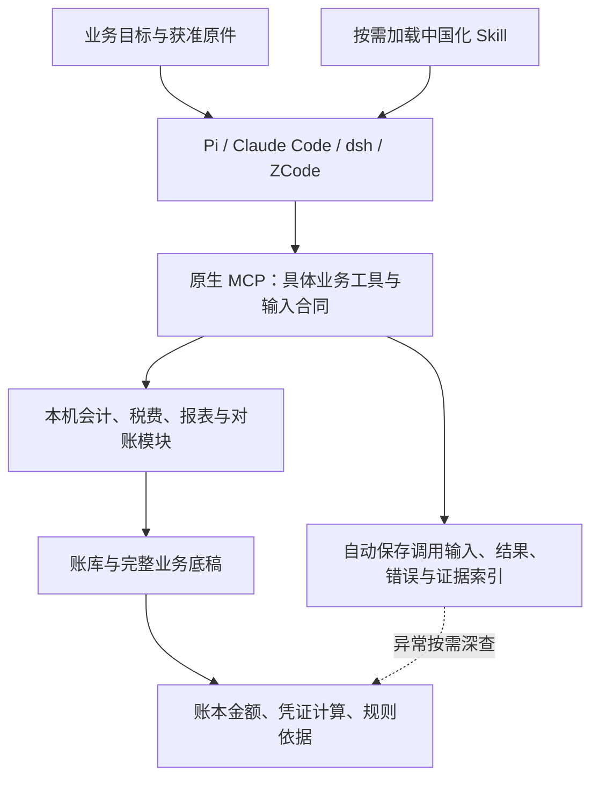

# 中国财税 Agent：直接业务调用与自动记录

业务 Skill 采用 Anthropic 官方插件的任务说明、输入资料、处理步骤、检查清单与输出格式。中国税会算法、账库与调用记录属于本项目后端实现；上游方法不是中国税法依据或准确率背书。

## 正常调用链

Agent 根据目标自主调查与选择工具；后台没有为它建立新的来源登记、事实登记、请求事实或任务 DAG。一次只读核对不要求先完成整套记账流程。正式写入继续调用原生会计能力，并保留人审、期间、防重复和结果未知时核查原操作等已有控制。

## 三类入口

| 入口 | 实现 | 职责 |
|---|---|---|
| Skill 与宿主 | `05-reconstruction/codex/skills/`、`hosts/`、Pi `finance-direct.ts` | 业务方法与按需披露，不重复维护税率或替代工具计算 |
| 财税 MCP | `mcp/finance-mcp/server.mjs`、`direct-tools.mjs`、`tool-profile.mjs` | 默认 direct 工具面、输入校验、真实模块分派、模型投影 |
| 原生业务 | `06-workbench/server/direct-finance.mjs`、`agency-business.mjs`、`accounting.mjs` | 已支持的底稿/税费/凭证/账簿/报表计算与受控写入 |

默认 direct 仅暴露实际可用的直接业务工具与普通会计模型通道，不暴露 Harness 生命周期、原始税务占位或本机原值读取通道。`finance_rules` 提供规则范围及官方链接，`finance_record_contract` 按类型披露字段、已有示例及完整度，区分仅通用引用、已核字段和只能由原生生成的记录，不能据此假定所有类型都有完整示例。`finance_workpaper`、`finance_annual_workpaper` 与 `finance_tax_calculate` 直接调用原生计算。`finance_tax_summary_calculate` 是独立条件试算：汇总输入逐值绑定原件JSON位置，完整结果另存summary产物；不放宽原完整底稿路径，也不把试算当作已核完整账、资格或实缴。模型仍自主选择工具，无新增登记流程。

客户原件与 Agent 整理的业务记录必须区分。目录和字段示例不是客户事实；原件未提供的日期、资格、用途、收付关联不得猜填。工具返回缺件、条件受限或不支持时，保留实际状态，独立可核分支继续。

## 自动调用记录

`finance-call-chain.mjs` 在最外层包裹每次 MCP 工具调用，记录参数拒绝、业务错误及成功返回。每次调用在 `FINANCE_AUDIT_DIR/<callId>/` 独立保存：

- `begin.json`：工具、时间、范围、输入文件摘要、观察到的原件摘要和记录器代码版本。
- `input.json`：经认证字段脱敏的完整调用输入，本机保存。
- `result.json` 或 `error.json`：完整返回或诊断，本机保存。
- `end.json`：结束时间、耗时、状态、结果摘要、规则/代码版本以及调用期间来源变化。

`_meta.financeCall.callId` 将 MCP 返回与本机记录关联。缺少结束文件明确为 incomplete；调用已返回但日志保存失败时，不宣称可以重复写入。独立记录避免并发工具互相覆盖，列表由文件目录重建，不新增任务状态库。

本机 `listFinanceCalls` / `readFinanceCall` / `verifyFinanceCalls` 供人工核查，不作为绕过模型投影的原值 MCP 通道。摘要核验只有每调用输入/结果哈希及 begin→end 绑定，没有外部可信锚点；不能声称不可篡改、原件真实、财税正确或已获人审。

原生 `local-audit-coordinator.mjs` / `local-audit-storage.mjs` 继续负责账库写入的操作身份、请求/结果摘要、凭证引用与事务恢复。它与自动 MCP 记录职责不同，既不替换原生写审计，也不要求 Agent 手工维护审计。

## 人工核对顺序

1. **账本金额**：企业、账套、期间、科目与关键余额，明确草稿和已入账。
2. **凭证／计算结果**：对应分录、计算过程、差额与缺件，不能用模型推导冒充工具结果。
3. **规则依据**：规则版本、官方条款、适用期间及事实条件。
4. **工具调用**：按需查看 callId、工具、状态、时间和具体诊断。
5. **输入与原件**：按需追到整理记录、原始文件与页/表/行/字段。

正常报告展示前三项。严重错误、多项错误或人工追查时再展开后两项；后台完整记录始终保留。应纳、计提、实缴与差额按原生字段分别表述，缺失或null不补成0。

## 宿主与渐进披露

`finance-host-config.mjs` 生成全新工作区，默认 profile=direct；`--plugin-root` 可选用中国化 fork 的 finance 插件，`--audit-dir` 可指定本机记录目录。Pi 使用原生 MCP 与 tool-search，初始只披露规则查询和 Skill 读取，其余工具按需加载；Claude Code、dsh、ZCode 使用各自原生 MCP/Skill 格式。工具面不是文件系统沙箱，生成配置不授予写账或资料外发权限。

## 历史兼容与验证

旧 Harness 源码、回执和回归保留为显式 `FINANCE_MCP_PROFILE=harness`；旧全量工具面须显式选 `legacy`。研究用 Harness² / SoL-Pi 默认关闭，不构成新日常业务依赖。历史元数据模型测试不能替代 direct 业务验收。

回归分别验证直接工具合同、实际业务结果、自动记录完整性、四宿主配置和原生写入控制；合成数据与临时账库是自动测试边界。Pi 模型只在全部改造、审查及 PR 后按既定测试集运行。

## 季度账表复核与渐进披露

`finance_quarter_review` 读取同一只读账库事务快照，汇总一个季度的科目余额（期间及结转前后可筛选）、利润表、资产负债表和小企业格式现金流量表。结转前余额是剔除本月实际损益结转后的重建口径，不能冒称历史快照；缺月、未关闭期间、草稿、缺映射与现金流待分类保持异常。报告不写账、不申报、不自动批准。

资料初读由受限 `quarter-read.mjs` 自动留存原件字节、结构、返回范围及时间；正常业务调用的可选 `businessEvidence` 只表达业务字段来源、转换、规则选择及现金流用途。MCP 先检验工具及基础合同，再在执行前实读获准 `FINANCE_SOURCE_ROOT` 内的原件，捕获完整表头、对应原行、实际参数和固定合同含义，拒绝逐值不一致。原说明不能覆盖工具真实字段含义。原件多层表头当前支持 CSV；工作簿仅支持明确工作表及单行唯一表头，复杂结构不能声称已解析。汇总试算已有 `originals/bindings` 时，在配置原件目录的调用中自动复用直接原件绑定；可信引擎派生引用继续由原生汇总工具核验，不伪装原始事实。

中文 HTML 默认先显示总览，随后按业务展开规则与参数、原始表头，再查看四表与凭证明细；技术调用编号放在深入核查区。JSON 数据包来自同一实际账库快照和有效调用记录，原件初读按相同文件摘要、路径及先后时间关联；没有此前读取记录时明确缺少记录。规则适用声明与确定性引擎实际采用的规则分别列示，数值匹配不能证明语义正确。现金流按实际现金凭证核对收付，使用调用前有来源的项目分配，允许一笔付款拆货款和设备款，重复或不足分配保留待分类。现金流业务分类的适用性保持待人工复核，不因分类金额对上就判政策通过。

`finance_workpaper_details` 是正常只读按需业务投影：使用本服务进程刚签发的底稿引用，分页返回固定凭证科目/借贷、原业务记录索引、库存层和退货成本；不允许任意路径读取。引用一小时有效，必须同账库、账套、期间及实例，工件与原件版本变化均拒绝。原名和原文不进入该投影，既有写账审核和过账控制保持独立。库存计算草稿不是持久化批次账，现库没有独立库存批次表，报告不能凭这些草稿宣称实账库存已经核验。

凭证金额映射可引用本进程签发的原生底稿固定分录：`sources:[{calculation:{artifactRef,voucherIndex,entryIndex,field:"debit"}}]`，`field` 只允许借方或贷方。此来源先校验同账库、主体、账套、期间、有效期、工件与原件版本，再校验实际传入金额；展示明确标注为计算结果，沿计算调用串回其规则及当时已记录的原件字段结构。它不支持任意 JSON 路径，也不把条件税费试算的所有结果自动当作凭证依据；未接通引用仍显示待核，不能复制派生文件冒充原件。凭证覆盖逐条检查非零金额，实际科目及选择方法随金额展示；零额与系统身份不要求重复绑定。报告关联使用后台实际观察的完整身份，HTTP 凭证写入还需本地同实例真实操作回执与目标凭证相符；配置地址与调用者身份声明不够。业务标识统一采用期间、凭证字、序号，数据库 ID 留在技术索引。原生数据包返回完整摘要与字节数供呈现端核验。
