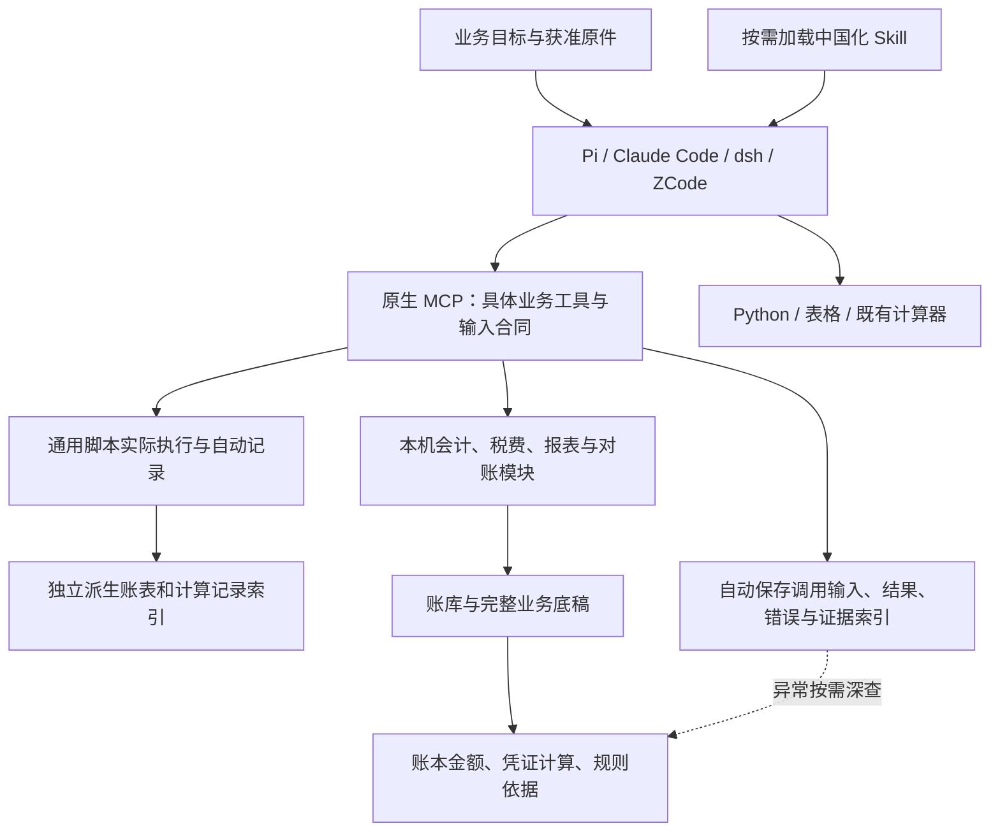

# 中国财税 Agent：直接业务调用与自动记录

业务 Skill 采用 Anthropic 官方插件的任务说明、输入资料、处理步骤、检查清单与输出格式。中国税会算法、账库与调用记录属于本项目后端实现；上游方法不是中国税法依据或准确率背书。

## 正常调用链

Agent 根据目标自主调查与选择工具；后台没有为它建立新的来源登记、事实登记、请求事实或任务 DAG。一次只读核对不要求先完成整套记账流程。正式写入继续调用原生会计能力，并保留人审、期间、防重复和结果未知时核查原操作等已有控制。

## 三类入口

| 入口 | 实现 | 职责 |
|---|---|---|
| Skill 与宿主 | `plugins/finance/skills/`、`05-reconstruction/codex/hosts/`、Pi `finance-direct.ts` | 业务方法与按需披露，选择计算载体与业务方法，明确规则来源和适用性 |
| 财税 MCP | `mcp/finance-mcp/server.mjs`、`direct-tools.mjs`、`tool-profile.mjs` | 默认 direct 工具面、输入校验、真实模块分派、模型投影 |
| 原生业务 | `06-workbench/server/direct-finance.mjs`、`agency-business.mjs`、`accounting.mjs` | 已支持的底稿/税费/凭证/账簿/报表计算与受控写入 |

默认 direct 仅暴露实际可用的直接业务工具与普通会计模型通道，不暴露 Harness 生命周期、原始税务占位或本机原值读取通道。`finance_rules` 提供规则范围及官方链接，`finance_record_contract` 按类型披露字段、已有示例及完整度，区分仅通用引用、已核字段和只能由原生生成的记录，不能据此假定所有类型都有完整示例。`finance_workpaper`、`finance_annual_workpaper` 与 `finance_tax_calculate` 直接调用原生计算。`finance_tax_summary_calculate` 是独立条件试算：汇总输入逐值绑定原件JSON位置，完整结果另存summary产物；不放宽原完整底稿路径，也不把试算当作已核完整账、资格或实缴。模型仍自主选择工具，无新增登记流程。

客户原件与 Agent 整理的业务记录必须区分。目录和字段示例不是客户事实；原件未提供的日期、资格、用途、收付关联不得猜填。工具返回缺件、条件受限或不支持时，保留实际状态，独立可核分支继续。

## 自动调用记录

`finance-call-chain.mjs` 在最外层包裹每次 MCP 工具调用，记录参数拒绝、业务错误及成功返回。每次调用在 `FINANCE_AUDIT_DIR/<callId>/` 独立保存：

- `begin.json`：工具、时间、范围、输入文件摘要、观察到的原件摘要和记录器代码版本。
- `input.json`：经认证字段脱敏的完整调用输入，本机保存。
- `result.json` 或 `error.json`：完整返回或诊断，本机保存。
- `end.json`：结束时间、耗时、状态、结果摘要、规则/代码版本以及调用期间来源变化。

`_meta.financeCall.callId` 将 MCP 返回与本机记录关联。缺少结束文件明确为 incomplete；调用已返回但日志保存失败时，不宣称可以重复写入。独立记录避免并发工具互相覆盖，列表由文件目录重建，不新增任务状态库。

本机 `listFinanceCalls` / `readFinanceCall` / `verifyFinanceCalls` 供人工核查，不作为绕过模型投影的原值 MCP 通道。摘要核验只有每调用输入/结果哈希及 begin→end 绑定，没有外部可信锚点；不能声称不可篡改、原件真实、财税正确或已获人审。

原生 `local-audit-coordinator.mjs` / `local-audit-storage.mjs` 继续负责账库写入的操作身份、请求/结果摘要、凭证引用与事务恢复。它与自动 MCP 记录职责不同，既不替换原生写审计，也不要求 Agent 手工维护审计。

## 人工核对顺序

1. **账本金额**：企业、账套、期间、科目与关键余额，明确草稿和已入账。
2. **凭证／计算结果**：对应分录、计算过程、差额与缺件，不能用模型推导冒充工具结果。
3. **规则依据**：规则版本、官方条款、适用期间及事实条件。
4. **工具调用**：按需查看 callId、工具、状态、时间和具体诊断。
5. **输入与原件**：按需追到整理记录、原始文件与页/表/行/字段。

正常报告展示前三项。严重错误、多项错误或人工追查时再展开后两项；后台完整记录始终保留。应纳、计提、实缴与差额按原生字段分别表述，缺失或null不补成0。

## 宿主与渐进披露

`finance-host-config.mjs` 生成全新工作区，默认 profile=direct，技能来自同仓库 `plugins/finance/skills`；不接受外部插件路径，`--audit-dir` 可指定本机记录目录。Pi 使用原生 MCP 与 tool-search，初始只披露规则查询和 Skill 读取，其余工具按需加载；Claude Code、dsh、ZCode 使用各自原生 MCP/Skill 格式。工具面不是文件系统沙箱，生成配置不授予写账或资料外发权限。

## 历史兼容与验证

九个中国化业务 Skill、共享参考、官方插件清单、MCP 配置、许可和来源记录统一维护于 `plugins/finance`。MCP direct 及四宿主生成器均读取此目录；`skills_list` 的文件和标签只来自当前 profile 的仓库内技能根。Claude 使用本仓库本地 marketplace 原位加载插件，`TAXES_AGENT_ROOT` 明确指向同一 clone 提供后端。插件 MCP 不接受缓存目录或其他技能路径；不按 `CLAUDE_PLUGIN_ROOT` 推算后端。

旧 `05-reconstruction/codex/skills` 的八个专用/兼容技能保持原处；harness/legacy MCP 固定使用该目录，direct 固定使用中文插件。遗留 `FINANCE_SKILLS_DIR` 仅允许断言对应内置绝对路径，不能更改来源；外部与相对目录启动即拒绝。季度 CLI 的插件同样固定为所选 productRoot 的 `plugins/finance`，只记录和锁定一个主仓库版本；旧外部插件参数和旧工作区插件路径配置明确拒绝。

旧 Harness 源码、回执和回归保留为显式 `FINANCE_MCP_PROFILE=harness`；旧全量工具面须显式选 `legacy`。研究用 Harness² / SoL-Pi 默认关闭，不构成新日常业务依赖。历史元数据模型测试不能替代 direct 业务验收。

回归分别验证直接工具合同、实际业务结果、自动记录完整性、四宿主配置和原生写入控制；合成数据与临时账库是自动测试边界。Pi 模型只在全部改造、审查及 PR 后按既定测试集运行。

## 季度账表复核与渐进披露

`finance_quarter_review` 读取同一只读账库事务快照，汇总一个季度的科目余额（期间及结转前后可筛选）、利润表、资产负债表和小企业格式现金流量表。结转前余额是剔除本月实际损益结转后的重建口径，不能冒称历史快照；缺月、未关闭期间、草稿、缺映射与现金流待分类保持异常。报告不写账、不申报、不自动批准。

资料初读由受限 `quarter-read.mjs` 自动留存原件字节、结构、返回范围及时间；正常业务调用的可选 `businessEvidence` 只表达业务字段来源、转换、规则选择及现金流用途。MCP 先检验工具及基础合同，再在执行前实读获准 `FINANCE_SOURCE_ROOT` 内的原件，捕获完整表头、对应原行、实际参数和固定合同含义，拒绝逐值不一致。原说明不能覆盖工具真实字段含义。原件多层表头当前支持 CSV；工作簿仅支持明确工作表及单行唯一表头，复杂结构不能声称已解析。汇总试算已有 `originals/bindings` 时，在配置原件目录的调用中自动复用直接原件绑定；可信引擎派生引用继续由原生汇总工具核验，不伪装原始事实。

中文 HTML 默认先显示总览，随后按业务展开规则与参数、原始表头，再查看四表与凭证明细；技术调用编号放在深入核查区。JSON 数据包来自同一实际账库快照和有效调用记录，原件初读按相同文件摘要、路径及先后时间关联；没有此前读取记录时明确缺少记录。规则适用声明与确定性引擎实际采用的规则分别列示，数值匹配不能证明语义正确。现金流按实际现金凭证核对收付，使用调用前有来源的项目分配，允许一笔付款拆货款和设备款，重复或不足分配保留待分类。现金流业务分类的适用性保持待人工复核，不因分类金额对上就判政策通过。

`finance_workpaper_details` 是正常只读按需业务投影：使用本服务进程刚签发的底稿引用，分页返回固定凭证科目/借贷、原业务记录索引、库存层和退货成本；不允许任意路径读取。引用一小时有效，必须同账库、账套、期间及实例，工件与原件版本变化均拒绝。原名和原文不进入该投影，既有写账审核和过账控制保持独立。库存计算草稿不是持久化批次账，现库没有独立库存批次表，报告不能凭这些草稿宣称实账库存已经核验。

凭证金额映射可引用本进程签发的原生底稿固定分录：`sources:[{calculation:{artifactRef,voucherIndex,entryIndex,field:"debit"}}]`，`field` 只允许借方或贷方。此来源先校验同账库、主体、账套、期间、有效期、工件与原件版本，再校验实际传入金额；展示明确标注为计算结果，沿计算调用串回其规则及当时已记录的原件字段结构。它不支持任意 JSON 路径，也不把条件税费试算的所有结果自动当作凭证依据；未接通引用仍显示待核，不能复制派生文件冒充原件。凭证覆盖逐条检查非零金额，实际科目及选择方法随金额展示；零额与系统身份不要求重复绑定。报告关联使用后台实际观察的完整身份，HTTP 凭证写入还需本地同实例真实操作回执与目标凭证相符；配置地址与调用者身份声明不够。业务标识统一采用期间、凭证字、序号，数据库 ID 留在技术索引。原生数据包返回完整摘要与字节数供呈现端核验。

季度报告另行采集同一账库实例、企业、账套与期间的可信核算回执中的未完成状态及 `review.issues`，不以是否提供 `businessEvidence` 为前提。HTML 在总览后直接展开“已知缺件及影响”，工作簿保留同名表，核对项明确需要处理；库存不足等事项的成本、利润和计税基础影响金额保持未知，不补零或代算。传输返回与业务完成分开，历史问题不会仅因后一次调用返回而自动消除，也不据历史问题断言现账必然漏记。该层只呈现已记录问题，不调整业务规则、原件、账簿或执行顺序。

未完成事项表示工具处理状态，不能推断企业未认证、无扣除资格或原件一定缺失；需要区分资料事实、字段表达限制与真实缺件。有已知未解决事项时，报告将账内利润等结果标为暂列、尚不可定稿，影响金额仍为未知。

## 模型自主计算与执行记录

`finance_calculation_run`在正常direct工具面可发现，由`direct-finance.mjs`分派至`finance-calculation.mjs`，无需账套、HTTP后端或完整底稿。Agent自主选Python、JavaScript、表格或已有计算器，专用引擎的业务字段条件仅约束其自身。通用入口接受脚本、自由参数与获准原件引用，不为比例拆分/重分类新增财务schema；正式写账仍使用既有受控能力。

运行器在`FINANCE_AUDIT_DIR/calculations/<runId>/`保存请求、脚本、实际输入、来源文件字节和结构、运行时版本及摘要、stdout/stderr、时间、文件输出索引与失败。每次新版本独立保存，`rerunOf`只关联同目录中真实旧记录且核对旧脚本/输入摘要；不构成不可篡改日志或完整环境锁定。结束核对来源文件、副本、脚本与输入变化。所有路径快照统一为source_snapshot（输入文件快照，来源性质待核）；路径授权及哈希不证明原件，派生文件再次作为输入也不升级其来源性质。CSV默认首行、JSON根结构以及可选精确locator分别标明；没有解析的复杂格式仅保存字节，不声称已读表头。

结果身份为`derived_calculation`、业务状态为`unreviewed`，可独立交付，不是`finance_quarter_review`快照。中文业务账表、规则、参数和缺件影响由脚本或宿主表格产出；自动HTML只叫计算记录与文件索引，不能充当完成的业务报告。原生季度报告及其专用导出保留为可选路径。

脚本使用明确程序和参数，禁用shell字符串，精简子进程环境，不传模型凭据或账库路径。此工具按操作系统用户权限运行，不是安全沙箱；不保证任意脚本无副作用，超时也不约束后代进程和内存。记录器本身不调用写账接口，工具注解明确非只读。未通过此工具的宿主Python/表格操作不声称已被自动观测。具体配置与大小边界见[自主计算合同](../05-reconstruction/codex/skills/harness/references/calculation.md)。

## 固定账务卡片交付层

`finance-review-card.mjs` 位于业务计算之后：`finance_calculation_run` 接收可选 `reviewCard`，读取本次已索引输出 JSON、核对其完整摘要，独立读取指定银行/盘点/复核输入快照，形成 `cn-finance-review-card/1` 数据 spec 并用固定中文模板渲染。格式为 `quarter-ledger/v1`，支持完整自然季度、明确科目/月度发生/报表字段；不是任意文件解析器，也不是业务算法或做账前置。

固定卡片默认看科目余额、银行与现金、税费及三报表，规则参数和技术记录按需追查。后台自动比较借贷、余额滚算、凭证发生、税费滚算、银行及现金独立输入差额；不判断税法适用或宣称审计通过。外部人工复核记录明确区分，未提供保持未知。金额点击保留原字段值，无法逐格映射就显示缺口。打印保留金额和待核事项。

实际计算记录关联输入输出、模板版本、数据/渲染器/spec/HTML摘要及runId/callId；成功reviewPath只指主卡片，失败独立记录并回退执行索引。旧Harness编排默认关闭，正式账库权限、人审、期间、防重复和审计控制继续独立。`quarter-review-worker.mjs` 的摘要覆盖实际scope、完整月份报表与结转前重建值，前期调账导致本季期初或累计变化时摘要随之变化；捕获时间不参与业务摘要。

## 正式入账的日期、金额与来源兜底

`voucher_create`、`voucher_post`、HTTP 及领域导入共用 `posting-evidence-guard.mjs`。它不建立任务 DAG，也不规定 Agent 的业务步骤。明确无效日期、跨期日期、非法金额、借贷不平、原件与参数不符返回 `correction_required / correct_input`；模型应根据原件修正，不能自动挪日期或配平。来源缺失、无法核对、业务选取尚未核实返回 `needs_review / human_review`。普通有源、数值匹配的凭证无需额外人工流程；大额不因金额大而被机械拒绝。

缺日期的草稿保存空日期并带待审信息，正式提交不会默认月初。直接要求正式入账而不满足条件时，业务库不写凭证；完整候选保存在尝试记录中。已经存在的草稿保持草稿。旧已过账凭证的幂等读取不回写，不据此宣称历史凭证已通过新增规则。

凭证借贷金额支持有符号红字，原方向与负号完整保存。单行借、贷不能同时非零；总借贷按有符号整数分相等。期初及其他业务工具仍遵循各自合同，不因红字支持而整体放宽。现金流遇到红字时保留实际现金余额变化并标记分类待核，不能把负数取绝对值、交换收付方向或自动配对。总账、损益和资产负债表按符号计算。

每次尝试在业务校验前向账库同目录的 `posting-attempts/<attemptId>/` 写入并刷新 `begin.json`，保留原始参数及非法数字的类型；`validation-*.json` 保存真实日期校验、原件位置/表头/原值、实际采用值、按分舍入规则和问题；`result.json` 保存结果、来源版本、原生操作 ID 和纠正关联。调用者的规则、理由均标为声明，不能冒充已核事实。记录只留本机；目录拒绝链接，单文件限制 20 MiB，独占创建，写入前记录失败即停止。业务成功后终态记录失败返回 `unknown / query_original_operation`，禁止换新操作 ID 盲目重做。

源金额 `1.005` 和实际采用的 `1.01` 分开保留。再过账继承旧来源时，仅当旧输入归一化后与当前凭证完全一致才复核旧原件；显式提供的新来源按当前提交核对。原件或凭证内容变化使旧审核失效。导入的每张凭证可提供自己的 `businessEvidence`；解析前金额通过 `amountInputEntries` 保留，只有按分等价才可使用，不能借此改变记账金额。

内部折旧和结转通过私有代码能力记录真实推导依据及月末日期规则，不能通过模型提交 `kind` 或 `reviewed` 冒充。外层事务未完成时内部尝试只记 `staged`；季度索引须再检查原生审计已提交且凭证与当前快照一致，才能采用其来源。MCP 创建调用仍保留原证据文件；HTTP、领域调用和补证过账由 `posting-evidence-index.mjs` 接入同一季度复核，稳定证据去重，真实规则或现金流分类变化不隐藏。

本机后台进程与 MCP 进程都必须配置获准原件目录 `FINANCE_SOURCE_ROOT`。后台独立实读原件，不接受模型传来“已经核对”的结果。仅给 MCP 配置来源目录不会给后台隐式授予读取范围。

人工接受通过本机交互命令进行：在同一 `WORKBENCH_DATA_DIR` 下执行 `node scripts/review-posting.mjs <账套ID> <attemptId>`。命令展示候选、问题和来源，要求操作者姓名声明、核对理由及完整确认文本。没有非交互 `--yes`、MCP 或 HTTP 审批接口。批准只绑定当前数据库、实际企业、账套、凭证内容和证据版本，并生成唯一 `approvedOperationId`；下一次提交必须显式使用该 ID，重试沿用该 ID，其他 ID 不能复用批准。无效日期、原值不符等硬错误不能批准；缺日期也不能用批准补成日期。新企业导入失败回滚后可审候选中的实际企业身份，不能将同一临时账套 ID 的批准转给另一企业。

这是现有本机单操作者的信任边界，不是身份认证平台或模型安全沙箱。拥有操作系统权限者仍能操作本机文件和命令。审核记录是操作者声明，正式入账仍须经过原有期间、权限、事务、幂等及业务校验。

导入金额单独复用 `import-amount.mjs` 的原有币符、规范千分位和正负号语法；普通凭证输入仍严格使用十进制格式。日志同时保存导入字符串、语法规则和实际采用的分金额，不改写原件制造匹配。后台还须与 MCP 显式使用同一受信 `FINANCE_AUDIT_DIR`，才能在不同进程核验原生底稿计算来源；实际目标账库由领域层传递，不能由模型声明。缺配置、来源变化或签发记录无法核验时保留待审。

原子导入含多张待审凭证时，本机审核以原生审计的完整请求摘要、数据库和真实企业身份绑定执行意图。后续审核会展示拟沿用的旧候选日期、金额、异常、旧理由和时间。只有旧审批组的执行已明确失败、事务无效果，才能由本次人工确认签发包含旧已审项与新项的不可变审批组及新的 `approvedOperationId`；旧失败回执不修改，不自动增加执行 attempt。未执行、待定、未知或已成功的旧组不能转签。每张实际候选仍须匹配自己受审的内容和原件版本，改其他凭证、来源、企业或完整请求不能复用审批。成功后使用同一组 ID 幂等回放，不重复入账。后台配置缺失、计算来源版本变化等技术问题不得靠人工接受绕过，须先恢复可核来源。
