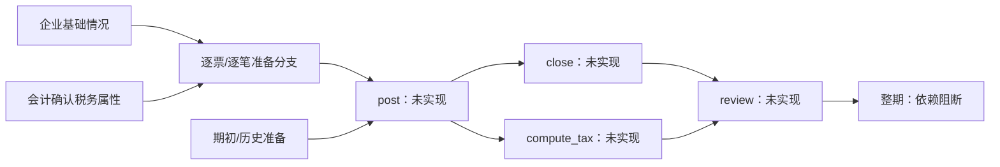

# OFFLINE-02A：本机资料完整度与解释性准备计划

Refs #79，基于已合 #78A / PR88（merge `a004bd889554c091318e5e017a93ec575581cf5e`）。本片新增纯评估、解释性准备 DAG、本机补件文本及选择性重规划 CLI；**不关闭 #79**。`ready` 仅表示可整理该笔资料包，输出 `business_evidence_packet` 的 `produced:false`，所有任务 `accountingEligibility:"not_assessed"`、`authorizesExecution:false`。本片不写账套、凭证、税额、数据库或执行回执，没有服务、HTTP/MCP/批量入口。

在 `06-workbench` 执行：

```powershell
node scripts/offline-plan.mjs --input C:\local\planning-input.json --output C:\local\new-plan.json
```

参数次序固定，输出必须不存在；只读取显式列出的文件，只写新 output。相对输入引用基于 planning-input 文件所在目录，output 相对当前工作目录。拒绝覆盖已有 output、报告、声明或既有链接。文件须 UTF-8（可带 BOM），每个 JSON 文件最多64 MiB；报告最多100份、去重后有效来源最多100个，来源格式和范围沿用 [OFFLINE-MATERIALS](OFFLINE-MATERIALS.md)。不扫描目录、不读取原件路径、不发消息。报告快照中原文不是此刻磁盘原件的真实性证明。

```json
{
  "version": "offline-planning-input/1",
  "scope": {"enterpriseKey":"SYNTHETIC-OWNER","accountSetId":"synthetic-book","period":"2026-Q3","currency":"CNY","unit":"yuan"},
  "reports": ["preflight.json", "supplement-preflight.json"],
  "declaration": "declaration.json",
  "previousPlan": "previous-plan.json"
}
```

`previousPlan` 可省略；无基础声明时明确 `declaration:null`，会生成企业情况、账户、期间覆盖、税务属性、工资资产、期初历史等基础请求，不能补默认值。期间可用规范季度或显式月份范围，跨企业/账套/期间/币种隔离，不将两种期间表示隐式等同。

退出码0只表示规划 JSON 写入成功，允许其中有缺项、无效、冲突或不支持；2为参数格式错误；4为 planning-input/previousPlan/输出读取或创建拒绝。stdout 仅固定 `OFFLINE_PLAN_WRITTEN sources=N records=N ready=N requests=N` 或固定错误类别，stderr 为空；路径、票号、原值、账户、补件文本均只在本机 output。输出仍可能包含敏感资料，应保留在本机。

## 基础声明

声明是严格原始情况 JSON，不接收预制凭证、分录、计算税额、执行状态或回执。顶层必填 `version:"offline-declaration/1"` 与相同 `scope`；以下字段可省略并形成缺项，未知键拒绝。完整可执行合成案例由 `test/offline-plan.test.mjs` 临时生成。

| 字段 | 支持结构与含义 |
| --- | --- |
| profile / businessScope | 当前可整理 `small-2011` / `service-company`，其他明确标 unsupported |
| evidence | `{evidenceId,kind,scope,confirmedBy:{name,role},basis}` 数组；kind 为 customer_declaration / registration_reference / attachment_reference，role 为 owner / business_operator / accountant；basis 不能为空 |
| enterpriseEvidenceIds | 企业基础情况依据的 evidenceId 数组 |
| bankAccounts | `{accountIds:["bank-A"],evidenceIds:["owner"]}`；明确本期全部账户，空列表只表示带依据声明无账户 |
| coverage | `{kind,accountId,from,to,state,sourceIds,evidenceIds}` 数组；kind sales/purchase/bank；非银行 accountId 为 null；state complete/partial/no_activity；起止月须对应完整 scope；sourceIds 须与对应来源匹配 |
| applicability | `{area,present,evidenceIds}` 数组，area payroll/assets；false 必须有同范围确认依据，且不得与已有付款/资产事实矛盾 |
| tax | `{vatStatus,filingFrequency,evidenceIds}`；身份 small_scale/general/unknown，周期 monthly/quarterly/unknown；须 accountant 角色的非附件确认依据，不采用默认税务属性 |
| opening | `{state,evidenceIds}`；state new_zero/balances_required/unknown，new_zero 不等于程序确认零余额 |
| history | `{state,evidenceIds}`；state first_period/prior_required/unknown；与期初声明相互核对 |
| bankFacts | `{bankAccountId,refId,nature,evidenceIds}` 数组；nature service_receipt/operating_payment/payroll/asset/unknown；逐笔与账户及流水号关联，不推断摘要含义 |
| materials | `{area,format,evidenceIds}` 数组；area payroll/assets/opening/history；只登记附件存在，当前均未解析、不冒充资料验证通过 |

每个依据同企业账套期间，引用编号必须存在。`attachment_reference` 仅表示附件登记；附件未解析不能替代有效声明。工资资产付款存在而无对应明细为 missing；已有未解析附件为 unsupported；带依据不适用为 not_applicable；不适用声明与实际事实矛盾为 conflict。缺期初、历史、税属性不能当零或默认小规模。新设零期初/首期声明需要明确依据，仍只作本机声明，不证明真实性。

## 评估与 DAG

每份报告从 `sources.rawContent` 重新计算 UTF-8 SHA-256 并调用 #78 纯标准化重放；不信任报告的派生 status/records/sourceVersion。损坏报告或来源单独隔离，其余合法来源保留。重复同源同内容去重；同 sourceId 不同版本标 conflict，保留其受影响票据/流水及业务 invoiceRef 关联，另一来源提供同票副本也不能隐藏已知冲突。同票跨 factId 的履约、日期、结算等事实矛盾会阻断对应分支；同稳定银行流水的全部版本进入局部摘要。

矩阵区分 provided_valid / provided_invalid / missing / conflict / unknown / not_applicable / unsupported，provided_valid 只表示结构或带依据声明满足当前资料条件。每行记录具体对象、原因 code、来源版本/文档摘要、覆盖范围和可接收资料。银行全部账户清单遗漏实际账户、销项/进项/逐账户无业务声明与已有记录矛盾，都会阻断对应逐笔任务；仅整期覆盖缺失、partial 或覆盖月份不足不阻断已独立明确的单笔资料整理，整期仍阻断。

任务记录 goal、requirements、deps、inputs、missing、blockedByTasks、risks、artifact 及局部 inputDigest。服务销售仅在明确已履约、未结算及基础声明满足当前条件时可整理资料包；**这不证明已取得收款权利，不确定主营/其他业务收入或增值税纳税义务**。已收/已付未有逐笔银行分配、未履约等均需澄清。采购 operating_service 不能区分项目成本与管理费用，必须澄清实际用途、对象及受益期间；不按票面或银行摘要自动认收入/费用。



post/close/compute_tax/review 是显式未实现节点，不能靠资料 ready 改成已执行；整期也不能 completed 或 ready_for_review。正式会计准入、规则评估、锁/恢复、凭证、结转结账、税额、确认和真实回执复用属于后续 #79/#80/#81/#82。另一窗口 #54 W2b 正在处理 accounting/import/db/coordinator/bank/aux/HTTP/MCP/batch 等核心共享窗口，本片不接这些核心。

## 补件与选择性重规划

`customerRequest` 合并同一矩阵缺项对多个任务的影响，已有效提供或有依据不适用的行不重复索取。机器字段保留 reason code、requestId/affectedTaskIds，中文 `forwardableText` 显示票号/销方或账户/流水等具体对象、所缺字段、固定中文原因及任务 goal，分别列出可接收原始材料和登记替代依据。登记/合同/验收说明可供操作者核对并录入支持的结构，不表示附件自动解析；不要求客户预制凭证、分录或税额。`delivery:"local_only_not_sent"`，本机文本生成不构成发送授权。

补件经 #78 重做预检后作为新 report 显式加入，previousPlan 仅作输入摘要比较，返回 added/removed/invalidated/unchanged。局部摘要包含对应来源全部冲突版本、实际相关声明/依据及规则版本和依赖摘要，不把整批 hash 注入每个任务；相关来源、更正、规则或依据更新才使该任务及其后继失效。相同计划可以 unchanged，但不复用完成状态或回执；previousPlan 自称 completed、executionReceipt 或摘要篡改会拒绝。重规划是纯计算，无正式接收持久化、跨批替换执行或回滚。

验证（`06-workbench`）：`node test/offline-plan.test.mjs`。测试采用临时合成文件及真实 CLI 子进程，覆盖独立分支、损坏来源、伪造派生状态、严格范围、同票跨事实冲突、账户/无业务声明矛盾、覆盖不全、工资资产/期初历史税属性、补件变化局部失效、中文清单、执行权限拒绝、stdout 与输出不覆盖。没有 package/test-all、DB、旧会计入口或原件变更；删除本片新增模块和文档即可回退，无迁移。
