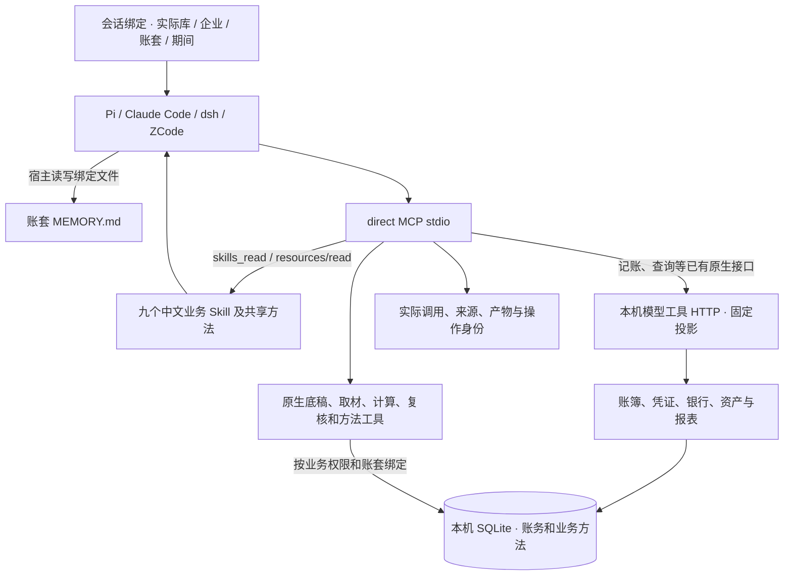
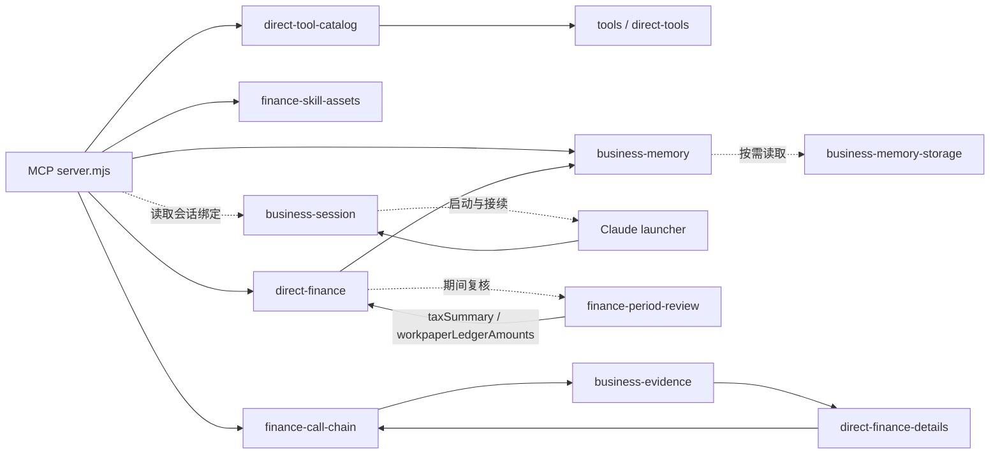

# direct 依赖体检

依赖边表示源码文件引用另一个文件。循环和入度用来定位改动波及范围。业务入口、读写和授权由实际工具合同、宿主绑定和原生领域接口决定。本文以 `e2864f3` 为拆分基线，统计范围为本次拆分后的主仓库。

## 正常业务调用

这张图按运行时调用画。宿主原生加载九个业务 Skill，MCP 也可按需披露同一份随包正文。`MEMORY.md` 保存账套口径，已选业务方法及案例另走本机领域存储。四宿主共用账套绑定。Claude Code 使用原生 Auto Memory，Pi、dsh 和 ZCode 使用各自的文件工具。

`callTool` 按工具名选择 `callDirectFinanceTool` 或 `callBackend`，`executeRecordedTool` 自动留痕。工作台 HTTP 的 `/api/business-baseline/materials` 只复用 `finance_baseline_materials`，stdio 仍是其余 direct 领域工具的发现和分派入口。 [MCP 服务](../05-reconstruction/codex/mcp/finance-mcp/server.mjs) · [本机 HTTP](../06-workbench/server/server.mjs) · [架构与调用链](AGENT-ARCHITECTURE.md)

## 核心源码依赖

实线为静态导入，虚线为已定位的字面量 `import()`。下图聚焦宿主、工具合约、技能清单、自动留痕和账套记忆。跨进程调用和实际读写见上图。

[工具目录](../05-reconstruction/codex/mcp/finance-mcp/direct-tool-catalog.mjs) · [Skill 清单](../06-workbench/server/finance-skill-assets.mjs) · [会话绑定](../05-reconstruction/codex/hosts/shared/business-session.mjs) · [原生记忆](../06-workbench/server/business-memory.mjs)

## 源码循环

静态导入有 **2 组**，纳入字面量动态导入后共 **6 组**。表中是强连通分量的代表边及成员范围。

| 类型 | 闭环与代表符号 |
| --- | --- |
| 静态 · 3 文件 | `finance-call-chain` → `business-evidence` → `direct-finance-details` → `finance-call-chain`，分别涉及 `captureBusinessEvidence`、`captureWorkpaperAmount`、`annotateFinanceCall`。 |
| 静态 7 文件 · 扩展后 10 文件 | `local-audit-storage` 与 `local-backup` 双向导入。另一支经 `local-write-lock`、`local-batch-storage` 回到审计。静态成员还含 `auxiliary-storage`、`bank-storage`、`business-memory-storage`。动态边并入 `db`、`import-storage`、`local-restore-batch`。 |
| 延迟 · 6 文件 | `business-session` 动态加载四宿主启动器及 Claude hook，启动器或 hook 再引用 `prepareBoundBusinessSession` 或 `loadBoundBusinessSession`。 |
| 延迟 · 2 文件 | `agency-business-rules` 引用 `agency-tax-rules`，`calculateAgencyAnnualAdjustments` 再动态读取 `replayAgencyFinancials`。 |
| 延迟 · 3 文件 | `direct-finance` 动态进入 `finance-period-review`，后者回用金额投影。`vat-period-handoff` 经 `loadRecord` / `safeFile` 连入同组。 |
| 延迟 · 2 文件 | `agent-tools` 在请求时取 `finance-model-entry.callModelTool`，模型入口将 `callAgentTool` 作为默认原生调用。 |

## 热点与维护范围

表中为运行源码去重后的直接本地导入。入度反映直接依赖该文件的模块数，出度反映该文件直接依赖的模块数。宿主绑定、记忆及技能清单在下表单列，便于定位当前产品入口。

| 文件 | 入度 | 出度 | 主要职责 |
| --- | ---: | ---: | --- |
| [offline-material-adapters](../06-workbench/server/offline-material-adapters.mjs) | 35 | 4 | `fields`、`validateScope`、`normalizeMaterial` 跨领域复用。 |
| [money](../06-workbench/server/money.mjs) | 27 | 0 | `parseMoney` 等金额基础合同。 |
| [direct-finance](../06-workbench/server/direct-finance.mjs) | 3 | 24 | `callDirectFinanceTool` 汇集不同业务入口。 |
| [local-audit-storage](../06-workbench/server/local-audit-storage.mjs) | 18 | 8 | `executePreparedOperation`、`withAuditSavepoint` 连接事务与恢复。 |
| [business-session](../05-reconstruction/codex/hosts/shared/business-session.mjs) | 15 | 7 | `prepareBoundBusinessSession` 核实会话身份与记忆路径。 |
| [MCP server](../05-reconstruction/codex/mcp/finance-mcp/server.mjs) | 0 | 21 | `callTool`、`executeRecordedTool` 组合目录、验证、分派与记录。 |
| [business-memory](../06-workbench/server/business-memory.mjs) | 5 | 11 | 依据账套与版本准备、读取、审阅和执行方法。 |
| [finance-skill-assets](../06-workbench/server/finance-skill-assets.mjs) | 4 | 0 | 中文 Skill 与受控旧资源名的随包声明。 |

用 Serena 2.1.0 和 TypeScript 5.9.3 索引 JS/TS 文件，采用 TypeScript AST 提取静态导入、再导出和字面量动态导入。文件对去重后用 Tarjan 算法求强连通分量。排除 `test/`、`tests/`、`evals/`、`fixtures/`、`upstream/` 和 `*-test.mjs` 后，运行源码有 **261 个文件、734 条静态边、827 条扩展边**。注册配置、文件访问和非字面量动态加载按实际入口核对。
