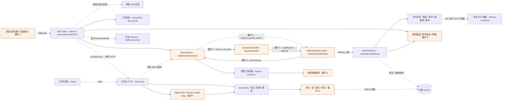

# 仓库依赖体检

基线 `e2864f3f453ebcc58eb977fb7b967070ae2de2fd`，检查日期 2026-11-28。Serena 索引了仓库跟踪的 562 个 JS/TS 文件。静态导入有 **2 组循环**，计入字面量动态导入后有 **6 组循环**。其中审计、写锁和备份恢复的循环最多扩展至 10 个文件。

## 核心模块依赖图

实线指向被静态导入的模块。虚线标出延迟导入、注册、HTTP 和子进程接线。标为“循环”的节点属于同一个强连通分量，具体闭环见下表。工具与业务能力的当前行为见[架构与调用链](AGENT-ARCHITECTURE.md)。

关键接线可以从符号直接定位。宿主注册看 Pi `financeDirect` 和共享 `prepareBoundBusinessSession`。MCP 看 `executeRecordedTool` → `callTool` → `callDirectFinanceTool` 或 `callBackend`。原生 HTTP 分派看 `callAgentModelTool`。整期交付看 `reviewFinancePeriod` → `reviewBoundDelivery` → `readDeliveryBooks`、`reviewInventory`、`reviewDeliveryVat` 和 `publishReviewedDelivery`。 [Pi 扩展](../05-reconstruction/codex/pi/finance-direct.ts) · [共享绑定](../05-reconstruction/codex/hosts/shared/business-session.mjs) · [MCP](../05-reconstruction/codex/mcp/finance-mcp/server.mjs) · [HTTP](../06-workbench/server/server.mjs) · [交付](../06-workbench/server/period-delivery.mjs)

## 循环依赖

每行是一组强连通分量。普通箭头表示静态导入，`⇢` 表示字面量 `import()`。表中列出可定位的闭环及触发路径。循环反映模块互相可达，运行时是否出错取决于初始化时机和调用条件。

| 组 | 闭环与符号 | 改动影响 |
| --- | --- | --- |
| **A · 静态 · 3 文件** | [business-evidence](../06-workbench/server/business-evidence.mjs#L7) → [direct-finance-details](../06-workbench/server/direct-finance-details.mjs#L9) → [finance-call-chain](../06-workbench/server/finance-call-chain.mjs#L7) → business-evidence。依次引用 `captureWorkpaperAmount`、`annotateFinanceCall` / `currentFinanceCall`、`captureBusinessEvidence` / `summaryBusinessEvidence`。 | 取证、金额语义和自动记录共享调用上下文。修改初始化或证据投影要连同记录与复核检查。 |
| **B · 静态 7 文件 · 扩展后 10 文件** | [local-audit-storage](../06-workbench/server/local-audit-storage.mjs#L1) ↔ [local-backup](../06-workbench/server/local-backup.mjs#L47)，绑定 `assertPrivateRestoreCapability`、`inspectAuditSchema` 等。另一支 audit-storage → [local-write-lock](../06-workbench/server/local-write-lock.mjs#L7) → [local-batch-storage](../06-workbench/server/local-batch-storage.mjs#L3) → audit-storage，连接 `assertWriteCommitFence`、`acquireLock`、`withAuditSavepoint`。静态成员还包括 `auxiliary-storage`、`bank-storage`、`business-memory-storage`。延迟边并入 [db](../06-workbench/server/db.mjs#L63)、[import-storage](../06-workbench/server/import-storage.mjs#L507)、[local-restore-batch](../06-workbench/server/local-restore-batch.mjs#L15)。 | 事务保存点、写锁围栏、恢复能力和组件 schema 互相约束。账库打开、备份、恢复和批次重跑的回归应覆盖受影响的共同路径。 |
| **C · 延迟 · 6 文件** | [business-session](../05-reconstruction/codex/hosts/shared/business-session.mjs#L116) ⇢ 四宿主 `launcher.mjs` 及 [Claude hook](../05-reconstruction/codex/hosts/claude-code/business-memory-hook.mjs#L5) → business-session。回边用 `prepareBoundBusinessSession` 或 `loadBoundBusinessSession`。 | 触发于会话准备与加载。改共享绑定或启动顺序会波及四宿主。 |
| **D · 延迟 · 2 文件** | [agency-business-rules](../06-workbench/server/agency-business-rules.mjs#L5) → [agency-tax-rules](../06-workbench/server/agency-tax-rules.mjs#L745) ⇢ agency-business-rules。业务规则用 `calculateAgencyObligations` 等，`calculateAgencyAnnualAdjustments` 动态取 `replayAgencyFinancials`。 | 年度调整与财务重演共享规则，应验证改动后的适用期及年度结果。 |
| **E · 延迟 · 3 文件** | [direct-finance](../06-workbench/server/direct-finance.mjs#L96) ⇢ [finance-period-review](../06-workbench/server/finance-period-review.mjs#L15) → direct-finance。增值税方案的另一支为 direct-finance ⇢ [vat-period-handoff](../06-workbench/server/vat-period-handoff.mjs#L7) → finance-period-review → direct-finance。回边用 `workpaperLedgerAmounts`、`taxSummary`，交接复用 `loadRecord` / `safeFile`。 | 期间复核跨回工具分派层取账表投影，月度增值税交接经同一记录读取边界。 |
| **F · 延迟 · 2 文件** | [agent-tools](../06-workbench/server/agent-tools.mjs#L704) ⇢ [finance-model-entry](../06-workbench/server/finance-model-entry.mjs#L13) → agent-tools。`callAgentModelTool` 延迟取得 `callModelTool`，模型入口的默认原生调用为 `callAgentTool`。 | 维护接口需要考虑投影、授权元数据和原生工具分派。 |

组 B 涉及的审计控制边界有一项既有错误。用 Node v24.15.0 从 `06-workbench` 运行 `node test/local-backup.test.mjs`，本次工作树与同一基线均在备份前的增量导入初始化失败。审计回调期间，`createAccountSet` 所走的 `registerPostingDatabase` 查询 `PRAGMA database_list`，被 SQLite 授权器拒绝，返回 `ERR_SQLITE_ERROR: not authorized`。 [入账证据守卫](../06-workbench/server/posting-evidence-guard.mjs#L14) · [审计授权器](../06-workbench/server/local-audit-storage.mjs#L498)

## 高耦合热点

按第一方运行源码中去重后的本地文件入度与出度之和排序，含字面量动态导入。入度是直接依赖该文件的模块数，出度是该文件直接依赖的模块数。相同总度按入度降序，下表补列两个关系到记录与数据库初始化的文件。

| 文件 | 入度 | 出度 | 总度 | 代表符号及耦合原因 |
| --- | ---: | ---: | ---: | --- |
| [offline-material-adapters.mjs](../06-workbench/server/offline-material-adapters.mjs) | 35 | 4 | 39 | `fields`、`validateScope`、`normalizeMaterial` 共用材料契约，字段形状或范围变更会扩散到多个领域。 |
| [money.mjs](../06-workbench/server/money.mjs) | 28 | 0 | 28 | `parseMoney`、`requireCents`、`sumCents`。这是高扇入的金额基础模块，优先守住符号、舍入和兼容合同。 |
| [local-audit-storage.mjs](../06-workbench/server/local-audit-storage.mjs) | 19 | 8 | 27 | `withAuditSavepoint`、`executePreparedOperation` 和组件检查串起事务、失败状态和恢复。 |
| [direct-finance.mjs](../06-workbench/server/direct-finance.mjs) | 3 | 24 | 27 | `callDirectFinanceTool` 聚合不同领域，`taxSummary` 又被期间复核引用。 |
| [MCP server.mjs](../05-reconstruction/codex/mcp/finance-mcp/server.mjs) | 0 | 27 | 27 | `callTool`、`executeRecordedTool` 聚合协议、校验、原生分派和记录。入口的高扇出符合其职责，改动需从 stdio 验证。 |
| [accounting.mjs](../06-workbench/server/accounting.mjs) | 10 | 15 | 25 | `createVoucher`、`correctVoucher`、`balanceSheet` 横跨凭证写入、纠正和报表，具体行为受审计和入账证据约束。 |
| [offline-material-store.mjs](../06-workbench/server/offline-material-store.mjs) | 22 | 2 | 24 | 本地材料记录和快照被计划、核对与复核共享。 |
| [local-audit-coordinator.mjs](../06-workbench/server/local-audit-coordinator.mjs) | 19 | 5 | 24 | `extractOperationMetadata` 与业务证据检查贯穿原生写路径。 |
| [finance-call-chain.mjs](../06-workbench/server/finance-call-chain.mjs) | 19 | 4 | 23 | `withFinanceCall`、`annotateFinanceCall` 维护自动记录上下文及 evidence 注入。 |
| [db.mjs](../06-workbench/server/db.mjs) | 17 | 6 | 23 | `db` 初始化 SQLite 与组件 schema，影响面包含写入口和只读查询。 |

## 扫描口径与验证范围

- 从 `git ls-files -z` 枚举基线的 953 个跟踪文件。Serena 2.1.0 使用 TypeScript 语言服务器 5.1.3 和 TypeScript 5.9.3，本地以只读配置执行 `serena project index --timeout 25 --log-level INFO .`。用 Serena `LspApi` 对 17 个文件取符号概览，对 20 个符号名查定义和引用。`callDirectFinanceTool` 的查询记录 MCP 与 HTTP 两个入口，`captureWorkpaperAmount` 记录 `captureBusinessEvidence` 的调用，`reviewBoundDelivery` 记录 `reviewFinancePeriod` 的动态分派。Serena 同时返回导入声明和调用位置，表中的入度按文件去重的导入边计算。
- 使用 TypeScript `createSourceFile` 遍历 `ImportDeclaration`、`ExportDeclaration`、字面量 `import()` / `require()`，记录本地目标、导入绑定及行号。对源文件、目标文件去重，以 Tarjan 算法求强连通分量。外部包、Node 内置模块与仅类型边不计为运行依赖。JS/TS 全集有 1,434 条静态边和 1,850 条含字面量动态导入的边。排除 `test/`、`tests/`、`evals/`、`fixtures/`、`upstream/` 和 `*-test.mjs` 后，315 个源码及脚本有 846 条静态边和 953 条扩展边。
- 解析范围内的本地字面量导入均找到跟踪目标。另见 50 处非字面量 JS/TS 加载表达式，未计入强连通分量和耦合度。配置选宿主、浏览器 `fetch`、MCP 配置装配和跨语言子进程按入口核查，图中只画核心接线。例如 `finance-host-config.mjs` 动态选择宿主 adapter，`voucher-correction-image.mjs` 启动本机 PowerShell OCR。 [宿主生成器](../06-workbench/scripts/finance-host-config.mjs) · [OCR 接线](../06-workbench/server/voucher-correction-image.mjs)
- 18 个 Python 文件均由 CPython `ast` 解析，能匹配仓库模块名的 12 条去重导入未形成循环。Harness² 的 Python 适配器与 Node bridge、SoL-Pi 的宿主加载均按各自研究或可选入口阅读。两个 PowerShell 文件和网页资源按调用入口检查，未纳入 JS/TS 图统计。 [Harness²](HARNESS2-INTEGRATION.md) · [SoL-Pi](SOL-PI-INTEGRATION.md) · [Windows 启动](../06-workbench/scripts/windows-start.ps1) · [网页入口](../06-workbench/public/index.html)
