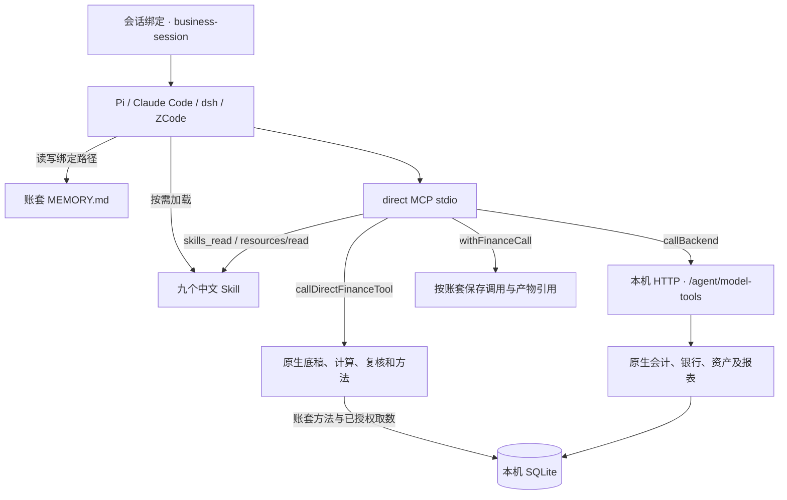

# 仓库架构地图

源码基线为 GitHub `main` 的 [`ad12981`](https://github.com/huxiaoyang-code/taxes-agent/commit/ad12981d75660f1c24c656c3a15cd3f7b26e8279)。当前产品使用 direct MCP、九个中文 Skill 和四种宿主的原生账套记忆。按业务看实际入口与验收，可继续读[架构与调用链](AGENT-ARCHITECTURE.md)和[代码索引](CODE-INDEX.md)。

## 核心目录职责

| 目录 | 职责 | 入口 |
| --- | --- | --- |
| `plugins/finance/skills/` | 提供业务选路、核对方法、适用条件、输出模板及共享参考。 | [中文 Skill 目录](../plugins/finance/README.md) |
| `05-reconstruction/codex/hosts/` | 生成和启动 Pi、Claude Code、dsh、ZCode 的本机工作区，绑定实际账库、企业、账套、期间、记忆和记录目录。 | [四宿主统一入口](../05-reconstruction/codex/hosts/START-HERE.md) · [会话绑定](../05-reconstruction/codex/hosts/shared/business-session.mjs) |
| `05-reconstruction/codex/pi/` | 用 Pi 原生扩展注册 direct stdio 及工具发现。 | [finance-direct.ts](../05-reconstruction/codex/pi/finance-direct.ts) |
| `05-reconstruction/codex/mcp/finance-mcp/` | 处理 stdio、工具发现、参数合同、原生业务分派、随包资源和模型可见结果。 | [MCP 服务](../05-reconstruction/codex/mcp/finance-mcp/server.mjs) · [工具目录](../05-reconstruction/codex/mcp/finance-mcp/direct-tool-catalog.mjs) |
| `06-workbench/server/` | 实现原生会计、税费、报表、账套方法、业务证据与 SQLite 存储，并提供工作台 HTTP 服务。 | [direct 领域分派](../06-workbench/server/direct-finance.mjs) · [HTTP 服务](../06-workbench/server/server.mjs) · [原生会计](../06-workbench/server/accounting.mjs) |
| `06-workbench/public/` | 本机工作台页面，通过 HTTP 读取和操作工作台。 | [网页入口](../06-workbench/public/index.html) · [页面代码](../06-workbench/public/app.js) |
| `06-workbench/scripts/` | 四宿主配置、Windows 启动与发包、统一测试以及本机审核命令。 | [宿主生成器](../06-workbench/scripts/finance-host-config.mjs) · [统一测试](../06-workbench/scripts/test-all.mjs) |
| `06-workbench/test/`、`plugins/finance/tests/` | 验证账务终态、工具合同、宿主路径和技能可读性，使用合成数据及独立预期。 | [测试入口](CODE-INDEX.md#tests) · [Skill 测试](../plugins/finance/tests/structure.test.mjs) |

## 模块依赖关系

图中的箭头表示运行时调用或读取。源码 `import`、循环和耦合度另见[依赖体检](REPOSITORY-DEPENDENCIES.md#核心源码依赖)。

- `tools/list` 和 `tools/call` 分别走发现及执行合同。`callTool` 按工具分派。工作台 HTTP 的 `/api/business-baseline/materials` 只复用 `finance_baseline_materials`。 [MCP 服务](../05-reconstruction/codex/mcp/finance-mcp/server.mjs) · [HTTP 路由](../06-workbench/server/server.mjs)
- `prepareBoundBusinessSession` 核定 `memoryPath` 和 `auditDir`。Claude Code 用原生 Auto Memory，Pi、dsh 和 ZCode 用各自的文件工具。`runBusinessMethod` 另从账库读取按版本保存的方法。 [账套记忆](../05-reconstruction/codex/hosts/BUSINESS-MEMORY.md) · [方法执行](../06-workbench/server/business-memory.mjs)

## 高频出错热点文件

以 direct 初次接入 `c0fb9f0` 到当前基线为样本。65 个非合并提交中，按标题的 `fix`、`repair`、`reconcile`、`修复`、`修正`、`纠正`、`错误`、`失败可恢复` 和 `恢复…发现` 筛出 12 个修复候选。下表按命中提交中修改现存源码的次数计数。一次提交可涉及多个文件，数字是修复历史信号，实际缺陷和生产故障频率需要另有记录。`test-all.mjs` 同期命中 4 次，属于验证入口的联动修改。

| 文件 | 修复候选命中 | 容易出错的边界 |
| --- | ---: | --- |
| [MCP server.mjs](../05-reconstruction/codex/mcp/finance-mcp/server.mjs) | 5 | 发现的 schema 与实际执行约束需一致。拒绝后保留字段级诊断和可执行下一步。 [Claude 发现修复](https://github.com/huxiaoyang-code/taxes-agent/commit/b7ec642) · [来源数量诊断](https://github.com/huxiaoyang-code/taxes-agent/commit/eaebe61) |
| [direct-recovery.mjs](../05-reconstruction/codex/mcp/finance-mcp/direct-recovery.mjs) | 2 | 失败回执需定位具体来源并给出可调用的重查步骤。 [材料恢复](https://github.com/huxiaoyang-code/taxes-agent/commit/0a5f03f) · [来源数量诊断](https://github.com/huxiaoyang-code/taxes-agent/commit/eaebe61) |
| [direct-tools.mjs](../05-reconstruction/codex/mcp/finance-mcp/direct-tools.mjs) | 2 | 工具声明与后端校验需共同覆盖材料取值和计算交付的输入分支。 [材料恢复](https://github.com/huxiaoyang-code/taxes-agent/commit/0a5f03f) · [固定复核卡片](https://github.com/huxiaoyang-code/taxes-agent/commit/eb01024) |
| [claude-direct-discovery.mjs](../06-workbench/scripts/claude-direct-discovery.mjs) · [direct-pi-probe.mjs](../06-workbench/scripts/direct-pi-probe.mjs) | 各 2 | 注册成功与宿主实际发现是两个验证点。Claude 还需区分账套绑定后的查询权限。 [宿主技能加载修复](https://github.com/huxiaoyang-code/taxes-agent/commit/50f7410) · [Pi 延迟发现修复](https://github.com/huxiaoyang-code/taxes-agent/commit/782ca4b) |
| [windows-delivery-check.mjs](../06-workbench/scripts/windows-delivery-check.mjs) | 2 | 源码包需包含宿主探针、技能资源及实际运行依赖。以冷拷贝后的 MCP 握手验证。 [发行清单测试](../06-workbench/test/windows-release-manifest.test.mjs) |
| [delivery-stock-invoices.mjs](../06-workbench/server/delivery-stock-invoices.mjs) | 2 | 红票和原票配对影响库存及交付复核。已完全冲销的折让需按真实关联判断。 [红票配对修复](https://github.com/huxiaoyang-code/taxes-agent/commit/b1a961f) · [返工复验](https://github.com/huxiaoyang-code/taxes-agent/commit/f69fb1f) |
| [finance-calculation.mjs](../06-workbench/server/finance-calculation.mjs) | 2 | 记录实际执行、来源和产物版本，跨期不能沿用过期版本。 [跨期版本修复](https://github.com/huxiaoyang-code/taxes-agent/commit/eb01024) · [计算回归](../06-workbench/test/finance-calculation.test.mjs) |

另有一处已复现的基线故障。`local-backup.test.mjs` 在合成账库增量导入初始化时，`registerPostingDatabase` 的 `PRAGMA database_list` 被审计授权器拒绝。该故障落在入账证据与审计事务交界，适合通过原回归定位。 [入账证据守卫](../06-workbench/server/posting-evidence-guard.mjs) · [审计存储](../06-workbench/server/local-audit-storage.mjs) · [迁移验收](https://github.com/huxiaoyang-code/taxes-agent/pull/166)

## 扫描口径

Serena 2.1.0 用 TypeScript 语言服务索引了 469 个 JS/TS 文件，并查到宿主绑定、MCP 分派、原生方法、入账和交付等 9 个符号的定义及引用。TypeScript AST 提取本地静态导入、再导出和字面量动态导入。第一方运行源码及脚本共 261 文件、734 条静态边、827 条含字面量动态导入的边，对应 2 组静态循环和 6 组扩展循环。文件系统访问、HTTP 路由与子进程按源码核对入口。 [循环与耦合度](REPOSITORY-DEPENDENCIES.md)
